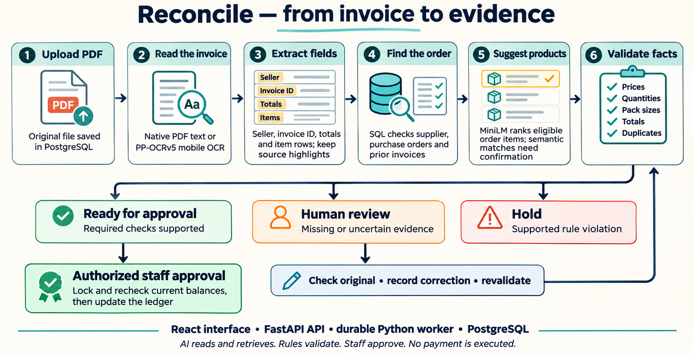

# Reconcile

Reconcile helps a finance team check supplier invoices before approving them. It compares each invoice with a **purchase order**: the company's record of what it agreed to buy, in what quantity, and at what price.

## Features

- **Open the public demo directly.** Explore the shared fictional workspace without entering a password.
- **Read invoice PDFs.** Upload a digital invoice or a scanned copy. The app reads the supplier, invoice number, totals and product rows.
- **Watch the work happen.** See which processing steps are running and inspect the result of each check.
- **Find the right order and products.** Search company records and suggest matching products, even when descriptions use different wording. A person confirms matches suggested from similar wording.
- **Check the details.** Compare item prices, quantities, totals, supported tax calculations and pack sizes. For example, six boxes become 600 items only when there is evidence of 100 items per box.
- **Catch duplicates and overbilling.** Look for earlier copies of an invoice and account for quantities already approved against an order.
- **Handle uncertainty through human review.** Highlight the original invoice so staff can verify unclear readings, correct them and run the checks again.
- **Keep a clear history.** Preserve original documents, readings, corrections, decisions and approvals. Staff can search past invoices and inspect remaining order balances.
- **Control final approval.** Only authorized approvers can approve an invoice. The app checks the latest order balance again before recording approval. It does not send payments.

The current workflow supports English invoices in Indian rupees, one purchase order per invoice, individual items and boxes with verified pack sizes. Other formats require manual handling.

## Architecture



### How an invoice moves through the app

1. **Upload and save.** A staff member uploads a PDF. The original file is saved so it can always be checked later.
2. **Read the document.** Digital PDFs provide their text directly. For scanned pages, **PP-OCRv5 mobile** reads words from the image. This is called OCR.
3. **Organize the information.** Parsing rules turn those words into fields and product rows, keeping links to their locations on the page.
4. **Find company records.** A database search, using SQL, finds the supplier, purchase order, earlier invoices and remaining quantities.
5. **Suggest matching products.** **MiniLM** compares the meaning of product descriptions and ranks likely matches from the eligible order. Its suggestions need human confirmation when wording alone supplies the match.
6. **Check the facts.** Business rules compare the invoice with the order. For example, if 1,000 items were ordered and 400 already approved, only 600 remain available.
7. **Show a recommendation.** The app explains the result using one of three outcomes:

   | Recommendation | What it means |
   |---|---|
   | **Ready for approval** | The required checks have supporting evidence. An authorized person can approve it. |
   | **Human review** | Important information is missing, unclear or uncertain. Someone must verify it and rerun the checks. |
   | **Hold** | Evidence supports a problem, such as a duplicate, incorrect price or excessive quantity. |

8. **Record the final action.** Corrections create a new result while preserving the original reading. Approval checks current balances again, records the approved quantities and saves the history.

### The four main parts

| Part | What it does |
|---|---|
| **Web interface — React** | The screens staff use to upload invoices, see progress, inspect evidence and review results. |
| **Application server — FastAPI** | Connects the screens to the processing and saved records. Checks who is allowed to perform each action. |
| **Background worker — Python** | Reads PDFs and runs checks while staff continue using the app. |
| **Database — PostgreSQL** | Stores company orders, original documents, results, corrections and approval history. |

## Repository structure

```text
backend/
├── reconcile/       Main application: read invoices, check them and handle review
├── migrations/      Instructions for creating and updating the database
└── tests/           Checks that the application behaves as expected

web/
├── src/             The screens, buttons and page styling
└── tests/           Checks that a person can complete the browser workflow

ml/                  Dataset preparation, model experiments and evaluation results
fixtures/            Fictional company/invoice examples and their expected outcomes
scripts/             Helpers for setup, sample PDFs and evaluation
docs/                Architecture images, explanations and detailed reports
deploy/              Instructions for packaging the application with Docker
notebooks/           Notebook used for the earlier GPU training experiment
reconcile-design/    Original product requirements and design notes

compose.yaml         Describes how the app, worker and database run together
vercel.json          Describes the hosted website and background worker on Vercel
Makefile             Shortcuts for common development and verification tasks
```

For a brief explanation of how the datasets were prepared, which edge cases were
checked and what results we obtained, read [Data preparation and edge-case results](docs/data-and-edge-cases.md).
For a visual walkthrough of the whole project, read the [illustrated report](docs/project-report.md)
or its [PDF version](docs/reports/reconcile-project-report.pdf).

Inside `backend/reconcile/`, these files handle the main steps:

| Files | Responsibility |
|---|---|
| `app.py`, `auth.py`, `invoice_api.py` | Sign-in, access permissions and actions requested from the web screens. |
| `worker.py`, `ingest.py` | Process uploaded invoices in the background. |
| `document_text.py`, `paddle_text.py` | Read text from digital PDFs and scanned pages. |
| `invoice_parser.py`, `gst_parser.py` | Organize document readings into invoice fields and item rows. |
| `retrieval.py` | Use MiniLM to suggest matching order products. |
| `business_validation.py`, `tax_validation.py`, `pipeline.py` | Compare invoice details with company records and explain the recommendation. |
| `workflows.py`, `history.py` | Preserve corrections, manage decisions and record approvals against current balances. |
