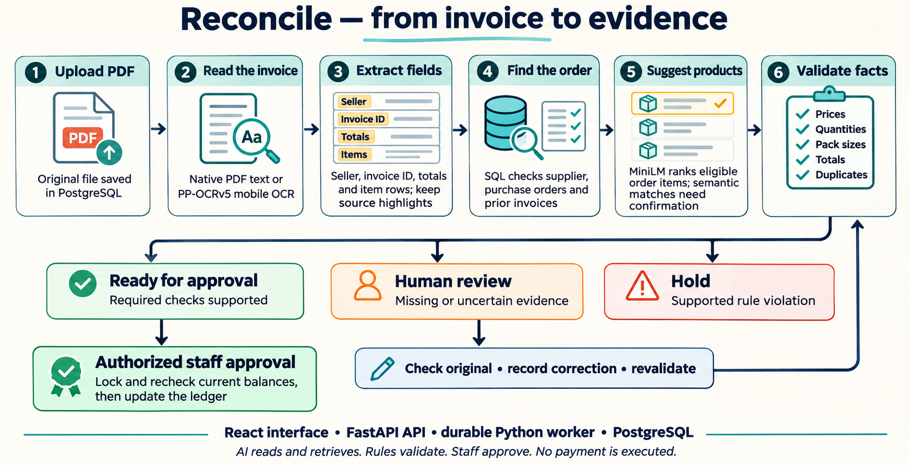
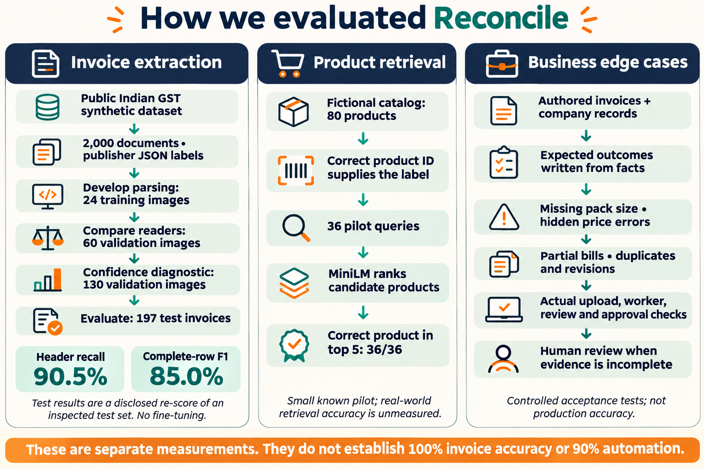

# Reconcile: the architecture in plain language

Reconcile checks whether a supplier invoice has enough supporting evidence to
approve against a purchase order. The current application runs locally with
React, FastAPI, a Python background worker and PostgreSQL.

## What happens to an invoice

1. **Keep the original PDF.** Authenticated staff upload the actual document.
   PostgreSQL stores its original bytes, and the worker records progress as each
   stage runs. A retry does not silently replace the document.
2. **Read its words.** Native PDFs supply their own text. Image-only pages use
   pretrained PP-OCRv5 English mobile on CPU. We did not fine-tune this OCR model.
3. **Organize the readings.** Parsing rules locate the seller, invoice identity,
   date when clear, totals and item rows. Page previews and source rectangles let
   staff check where a reading came from. Missing data is not filled from the PO.
4. **Load company facts.** SQL retrieves supplier eligibility, purchase orders,
   earlier invoices and allocated quantities/value. Duplicate detection uses
   identity/file evidence; it is not a MiniLM similarity decision.
5. **Suggest matching products.** Frozen MiniLM embeddings rank eligible product
   descriptions. Explicit printed identity can be checked deterministically;
   semantic matches require a person's confirmation. “None of these” is allowed.
6. **Compare the facts.** Decimal arithmetic checks prices, quantities, evidenced
   box conversions, totals, supported separated tax and cumulative order balances.
   The app recommends ready for approval, human review, or hold, with reasons.
7. **Resolve uncertainty.** Staff compare the original and company evidence,
   record corrections/attestations, and rerun validation. Original readings remain
   visible alongside the new decision version. A model score is not proof.
8. **Approve against current records.** An authorized approver triggers a locked
   recheck. Changed balances can block approval even if an earlier recommendation
   was ready. Repeated approval has one allocation effect. No payment is executed.

Human review has no direct shortcut to approval: the corrected document must pass
validation first. Holds remain explainable recommendations until staff record a
final disposition.

## How the data, labels and measurements fit together

| Track | Where the correct answer comes from | What was measured |
|---|---|---|
| Invoice extraction | Original publisher JSON for synthetic Indian GST invoice images | On 197 test invoices: 90.5% five-header recall, 98.0% precision among proposed headers, and 85.0% complete-row F1 |
| Product retrieval | Authored catalog identity: the query's correct product ID | Correct product appears in the top five for 36/36 known pilot queries against 80 fictional products |
| Business decisions and persistence | Explicit authored invoice/order facts and expected rule outcomes | Controlled missing-pack, offsetting-price, partial/concurrent-billing and duplicate/revision checks through the actual application |

The main invoice dataset contains 2,000 records. Its publisher split column is
used even though the loader exposes one aggregate split. Parser development uses
24 training images, model selection uses 60 validation images, and confidence
diagnosis uses a different 130 validation images. Labels are joined after reader
inference; no Nemotron or OCR-generated answer is used as ground truth.

The 197 test invoices were already inspected in an earlier baseline, and the
current numbers are a disclosed re-score. The sources are synthetic, share
recurring products and have not had an independent human annotation audit.
See [extraction details](indian-gst-evaluation.md) and the [model comparison](ocr-upgrade.md).

Header recall counts correct fields out of expected fields; it is not the
percentage of invoices safe to approve. Row F1 penalizes incorrect, missing and
extra complete rows. The retrieval pilot and business scenarios have different
labels and populations, so their scores cannot be averaged with OCR accuracy.

The [focused submission edge report](submission-edge-cases.md) records actual
expected/observed evidence. On its scanned control, the mobile OCR reads `EA/box`
as `EAbox`; source checking correctly routes it to review. A simulated reviewer
correction verifies recovery, not independent human accuracy or correct OCR.

## Current boundaries

Automatic checks cover the supported English/INR, single-PO, individual-item and
explicit box-conversion workflow. Bundles, mixed/inclusive tax, credit notes and
extra charges require manual handling. Low OCR scores trigger source review, but
high scores can still be wrong. Neither 100% invoice accuracy nor 90% automation
has been demonstrated on representative unseen invoices. Public deployment is
pending.

The diagrams are AI-generated documentation illustrations, not screenshots or
measurements. Their text was checked against the implementation and saved reports.
