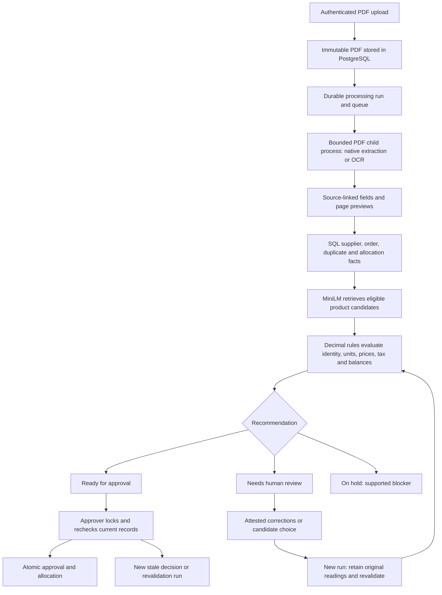

# Local application: implementation and operations

The local upload-to-review-to-approval workflow is implemented. This milestone excludes cloud hosting, public access, payment execution and submission to the hiring coordinator.

## Flow



A software rejection recommendation is displayed as **On hold**. Final rejection is a separate human action with a reason. A parsing/worker failure is **Processing failed**, never a business rejection. Every acceptance remains a recommendation until a staff approver acts.

## Persistence and recovery

Migration `0002_application` expands the previous schema. New `submissions` hold all uploads, including unresolved documents. Existing `invoices` retain their meaning as trusted ledger inputs. The application creates a ledger invoice only inside an authorised approval transaction. Missing invoice fields therefore never need invented vendor IDs or amounts merely to be stored.

Documents are content-addressed binary data in PostgreSQL. Independent submissions may reference identical bytes. All source readings, page coordinates/previews, effective values, corrections, review attestations, decisions and events are retained. New decision versions append; corrections do not overwrite original readings. The ordinary database volume survives application/worker restarts.

`runs` also implements the durable job queue: `queued → running → completed`, or retry/failure. PostgreSQL `SKIP LOCKED` claims work; each attempt increments a fencing token. Leases last 60 seconds and renew every five seconds. Expired work is recovered, with at most three attempts. Finalization checks current ownership, fence and lease, then writes exactly one decision in the same transaction as completion. A worker killed mid-OCR is covered by a real integration test, with accelerated lease expiry for test speed.

The PDF child receives no database/provider credentials, and has CPU, address-space, file-descriptor, page-dimension and input-size limits. The parent enforces a wall timeout and kills its process group on timeout. Linux parent-death signalling stops the child if its worker dies. Production Compose services run as a non-root user, drop capabilities, use read-only filesystems and bounded temporary storage.

Events are emitted while work actually executes; the browser polls saved events. Native-only documents explicitly skip OCR. A review run reuses immutable extraction and skips intake/text/OCR. It still retrieves candidates and reruns checks. A failed revalidation must be retried with its saved inputs before another review can be queued; it cannot silently fall back to an earlier successful decision. There are no simulated progress delays.

## Matching and evidence

The runtime uses the pinned Apache-2.0 `sentence-transformers/all-MiniLM-L6-v2` ONNX model, revision `1110a243fdf4706b3f48f1d95db1a4f5529b4d41`. Downloaded tokenizer/model checksums are pinned in code. Inference uses CPU, attention-masked mean pooling and L2 normalization. Setup downloads weights; invoice processing does not contact Hugging Face or OpenRouter.

Supplier and explicit-PO eligibility filter candidates before actionable suggestions. Closed or otherwise ineligible orders appear separately as historical context. Embeddings receive identity descriptions and product codes, never prices, quantities, balances or expected labels. Top five candidates are rankings, not calibrated confidence probabilities. Unknown supplier identity yields no forced semantic match.

Explicit SKU and matching attributes can confirm identity without model-score thresholds. Otherwise the reviewer chooses an eligible candidate and supplies an evidence-based reason. **None of these** keeps the item unresolved, including when an exact code might otherwise match. Explicit material/size conflicts cannot be bypassed by selecting a candidate. Missing pack sizes remain unresolved until printed evidence or a recorded human attestation supplies a conversion.

The original reading and its source box remain visible after correction. A minimum OCR word score below 60 flags the reading for verification rather than using its value automatically. This is an operational abstention heuristic, not a calibrated error probability or future precision guarantee. The original value and engine score remain stored.

## Business and approval policy

Policy `local-ap-2026.11.3` uses decimal strings, `Decimal`, database NUMERIC and `ROUND_HALF_UP`. Invoice amounts are net unless explicitly supported otherwise. Unit-price tolerance is inclusive `max(INR 0.05, 1% of PO unit price)`. Quantity tolerance is zero. Cumulative order-value tolerance is fixed per line at `max(INR 1, 1% of the original authorised line value)`; it does not reset for every split invoice.

Separate tax checks require a printed or human-attested combined rate and the order's uniform classification. Printed CGST+SGST rates can be combined with both source spans retained. A missing/mixed classification or rate remains review. A clear tax arithmetic discrepancy blocks. Explicit zero tax matching a zero-rated fictional order can pass without inventing a printed rate. The tax-amount tolerance is INR 0.10. Unsupported inclusive/mixed bases, bundles, discounts, additional charges and credit notes remain manual cases; calculations on an unsupported basis do not justify false arithmetic/price rejections.

All invoice rows assigned to the same order line are aggregated. Both remaining quantity and cumulative net value are checked. Recommendations have no ledger effect. During approval the application locks supplier, order, submission and order lines consistently with the existing history service, then reevaluates current data. A changed master record/policy queues revalidation. A changed balance/duplicate outcome creates a new `approval_check` decision and returns `APPROVAL_STALE`. Approval replay has exactly one allocation effect.

Duplicate history includes SQL ledger records and earlier non-rejected uploads. A later accidental copy cannot block the original upload. Same vendor/printed number with a different total is review, while confirmed file/business duplicates block. Another vendor's same invoice number is not sufficient duplicate evidence. Links to previous application records appear with duplicate findings when available.

## Staff access and HTTP

Argon2id hashing uses `pwdlib`; raw passwords are never stored. Sessions use 32-byte random tokens, only their SHA-256 digests in PostgreSQL, with 12-hour expiry and explicit revocation at logout/password change. There is no public registration. Roles are clerk (upload/review/reject), approver (also approve), and admin (read/diagnostics; no invoice actions).

Unsafe API calls require `X-Reconcile-Client: web` and an allowed Origin when present. Cookies are HttpOnly and SameSite=Lax. Local HTTP defaults to `SESSION_COOKIE_SECURE=false`; HTTPS operation requires setting it true and configuring exact `APP_ORIGINS`. Mutations use user/resource-scoped UUID idempotency keys, request hashes, transaction advisory locks and responses stored with their business effects. Changed-payload key reuse is rejected. Errors avoid echoing passwords or document contents.

Login limits are persistent per IP/email pair, and upload limits are persistent per user. API documents and previews require authentication and are private/no-store. Raw PDFs download as attachments; the UI displays derived image previews. React renders text values without raw HTML. The app uses a same-origin CSP and no third-party scripts/fonts.

## Commands

```sh
make local
# Provision/change one account without putting a password in shell history:
docker compose exec app python -m reconcile.cli user --email you@example.invalid --role approver
# Inspect real persisted state:
docker compose exec -T app python -m reconcile.cli verify-db
docker compose exec -T app python -m reconcile.cli latency-report
# Stop processes, retaining the database volume:
docker compose down
```

`make local` creates `.env` only if absent, preserves existing database records and provisions three local accounts from a private file. Repeat provisioning revokes existing sessions. Use `scripts/local_accounts.py --output /private/path/accounts.json` to choose a different private file.

For non-demo company data, prepare JSON with exactly `vendors` and `purchase_orders` and run `python -m reconcile.cli import-company /path/company.json` in the application environment. Purchase orders reference `vendor_name`, `number`, `order_date`, optional `status`/`currency`, and `lines`. Each line has `sku`, `description`, `material`, `size`, `uom: "EA"`, decimal-string `ordered_qty`/`unit_price`, and optional decimal-fraction `tax_rate` (for example `"0.18"`). Missing tax classifications require review. Allocations, policy and invoice history cannot be imported through this command. Existing allocated product identities cannot be replaced, or ordered values reduced below approved balances.

`/health/live` checks process liveness. `/health/ready` checks database, migration head, blob-table access, actual model loading/checksums, Tesseract and recent worker heartbeat. Admin diagnostics include run failures, active work, database size and audit activity. The CLI verifies document hashes, nonnegative remaining quantities, active-run uniqueness and current-decision pointers.

## Evaluation and deliberate limits

`make integration-test` runs the full suite against real PostgreSQL with isolated schemas; the ordinary unit command intentionally skips DB tests unless explicitly configured. `make browser-test` starts a separate disposable company/app on loopback port 18000; its fixed credentials are **test-only**, and its schema is removed on shutdown. It does not reset the main company's history. The browser test includes axe scans and mobile overflow checks.

The original workflow-v1 labels and failed runs remain unchanged. That historical benchmark tests the bounded validator and controlled PDF representations. The live application adds tax classifications, OCR quality abstention, persistence and reviewer actions; its integration tests are a separate result. CPU/GPU embedding parity reuses the inspected 36-query diagnostic, not a new blind benchmark.

Independent human label audit, representative unseen invoice accuracy, calibration and sustained 90% invoice automation are not established. The fine-tuned cross-encoder and Nemotron proposal experiment are not live automation policies. English/INR, one PO, individual-item lines and evidenced box conversions define the supported automatic scope; other cases stay review. Approval reversal, bank/payment integration, multi-tenant isolation and jurisdiction-complete tax compliance are outside this local case-study release. No cloud deployment or external messages were performed.

## Completed verification

The final full run passed **179 tests against real PostgreSQL**, including every original DB test and the new application tests, with zero skipped. The ordinary host-only run passes 143 tests and explicitly skips 36 DB tests. One complete Playwright journey passed; axe reported zero violations in the tested login and mobile workspace. The frozen generic validator regression still passes 25 authored oracles, 100 PDF assignments and three stateful traces. These counts are not independent statistical accuracy samples.

Production-container smoke checks also run with UID 10001 and read-only root filesystems. Native/scanned input bytes, source previews and unchanged recommendation-side balances were verified. A randomly generated scanned reference triggered the low-score gate. Its original failed all-accept smoke expectation is retained, and a source-checked agent correction produced a new successful decision without overwriting extraction. This demonstrates the review fallback, not perfect OCR. Reports distinguish initial readings, simulated staff corrections, and final recommendations.
