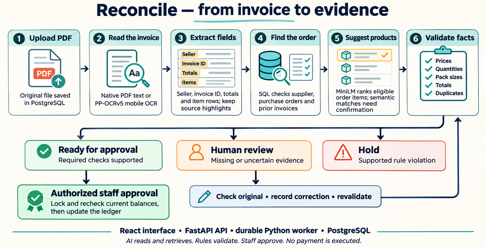
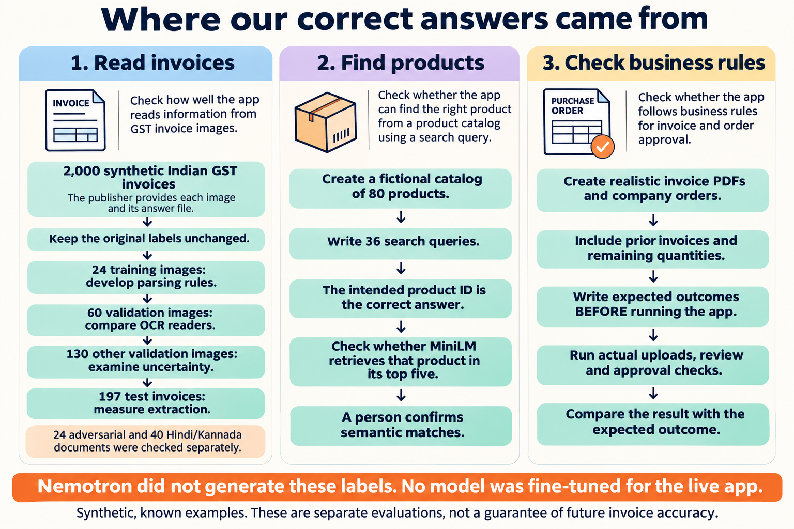
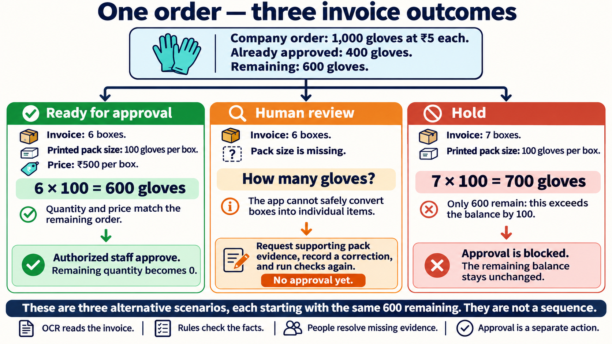

# Reconcile: the project explained

Personal reading guide · 12 November 2026

Reconcile helps a finance team check a supplier invoice before approving it.
A **purchase order** is the company's agreed shopping list: the products,
quantities and prices it authorized. The app compares the invoice with that order
and explains what needs attention. It never sends a payment.

**The roles are different:** mobile OCR reads the document; SQL retrieves company
facts; MiniLM suggests matching products; rules check the numbers; staff resolve
uncertainty and give final approval. Similar wording alone cannot approve an invoice.

<!-- pagebreak -->

## 1. How the data and correct answers were prepared

We tested three separate tasks. Each needs its own correct answers, also called
**labels**. An invoice image alone cannot tell us whether the company should approve it.

The invoice source is **Divya52/indian-gst-invoices**, a public synthetic dataset.
Examples cover four layouts and clean, scanned and photographed pages. Original
images were wrapped in PDFs to exercise our reader. Fixed selections and file
checksums kept comparisons consistent; publisher answers were not rewritten.

<!-- pagebreak -->

## 2. What the models do and what the scores mean

The live app uses pretrained **PP-OCRv5 mobile** to read scans and pretrained
**all-MiniLM-L6-v2** to retrieve products. Neither was fine-tuned for the live app.
An earlier experiment trained a separate matching model; that model is not deployed.

| Measurement | Result | Plain meaning |
|---|---|---|
| Five key invoice fields recovered | **90.5%** | 891 correct values out of 985 expected values on 197 invoices. |
| Correctness of proposed field values | **98.0%** | 891 correct values out of the 909 values the reader supplied. Missing values are counted separately. |
| Complete item-row F1 | **85.0%** | A score that penalizes wrong, missing and extra rows. Description, quantity, price and amount must all match. |
| All five key fields correct together | **60.9%** | Only 120 of 197 invoices had all five key fields correct. Field recovery is not whole-invoice accuracy. |
| Product-retrieval pilot | **36/36** | The intended product appeared within the top five suggestions among 80 fictional products. |

The five fields are seller, invoice number, date, net subtotal and grand total.
Date recovery was **131/197**; unclear dates were withheld. Excluding date gives
**760/788 = 96.4%** field recovery, an additional analysis. The original five-field
score remains 90.5%, and the app still asks for a missing required date.

<!-- pagebreak -->

## 3. Why we selected the mobile reader

A larger model is not automatically a better reader for our invoices. We compared
readers on the same small set before choosing the one used in the app.

| Reader | Approximate size | Key fields recovered | Complete-row F1 |
|---|---|---|---|
| PP-OCRv5 mobile | 3.1 million stored values | **90.0%** | **83.3%** |
| PP-OCRv5 server | 43.1 million stored values | 81.7% | 81.5% |
| PaddleOCR-VL | 905.6 million parameters | 86.7% | 65.3% |
| Granite Docling | 257.5 million parameters | 50.0% | 0.0% |

This smaller comparison used the same **12 validation examples**, not the 197-test
set. Larger vision-model results are limited prototype/adaptor qualifications,
not full official layout/table-pipeline benchmarks. The mobile reader worked best
in our tested setup and runs on CPU without a Kaggle GPU.

**What we adjusted:** rules that organize the extracted words into invoice fields
and rows, including their page coordinates. We did not retrain the mobile model's
weights. These scores measure the reader together with our parsing rules.

**What MiniLM does:** it turns a product description into a list of numbers that
captures its meaning. We compare those numbers with products from the eligible
company order and show the closest candidates. A person confirms a match based
only on similar wording. MiniLM does not read scans or decide whether an invoice
is a duplicate; database checks handle invoice history.

<!-- pagebreak -->

## 4. A concrete example: ready, review or hold

Each branch below starts with the same company facts. The expected outcome comes
from those facts and simple arithmetic, not an answer generated by the model.

**Ready for approval is a recommendation.** An authorized person must still approve.
At that moment, the app checks the latest balance again. It also prevents a repeated
approval from consuming the same quantity twice.

<!-- pagebreak -->

## 5. Edge cases and the human-review fallback

We authored realistic PDF invoices and company records, then wrote expected
outcomes before running the checks. These were implementation-agent-authored
expectations, not independently audited human labels and not Nemotron labels.

| Edge case | Why it matters | Observed result |
|---|---|---|
| Six boxes without a pack size | The order counts individual items; the app cannot know how many are in each box. | **Human review.** Approval is blocked until supporting pack information is supplied and checks are rerun. |
| Correct total hides wrong prices | One product is overpriced by ₹1 and another underpriced by ₹1, so the total still matches. | **Hold.** Both item-price errors are identified. |
| Partial and competing invoices | 1,000 ordered minus 400 already approved leaves 600; separate approvals can compete for it. | **600 passes; 700 is blocked.** Two 400-item approvals cannot both succeed. |
| Duplicate invoice in another layout | File bytes can change while supplier, invoice number and amount remain the same. | **Duplicate held.** Another supplier's same number is allowed; a changed total goes to revision review. |

**All 11 controlled application checks passed:** nine variants across these four
groups, plus a normal invoice and an image-only scan. They exercised actual
uploads, processing, saved decisions and review/approval actions where relevant.

### What happened when OCR made a mistake

The scan read `EA/box` as `EAbox`. Its description score was about **52.2**, below
the source-review threshold of 60. The app kept the original reading and requested
human review. A simulated reviewer restored the exact printed text; the new result
became ready while the original reading stayed visible. That correction is **not**
counted as correct OCR or independently measured human-review accuracy.

Missing information, uncertain matches and unsupported invoice formats stay in
review. Low similarity alone never justifies rejection. Corrupt PDFs produce a
processing error with retry, rather than an invoice rejection.

**Limits of the evidence:** these are synthetic, known examples. The public invoice
test was already inspected and later re-scored. Some OCR errors have high scores.
Neither 100% future accuracy nor 90% invoice automation has been demonstrated.

<!-- pagebreak -->

## 6. What is complete and how to resume the demo

The website and persistent database were deployed successfully. **The OCR worker
was paused at your request on 12 November 2026: zero running instances.** New
invoice processing waits until it is resumed. Saved documents, corrections and
approvals remain in the database.

| Completed part | Evidence |
|---|---|
| Upload, OCR, order lookup, product suggestions and checks | Implemented in the app, with source highlights and explanations. |
| Staff review, correction history and authorized approval | Original readings retained; current balances rechecked before approval. |
| Persistent hosting | Vercel website/API, separate CPU worker and Neon PostgreSQL. |
| Software and live verification | **216 tests passed**, 11 live API checks passed, and the browser journey passed. |
| Persistence after redeployment | Existing session, original PDF, saved approval and balances survived. |

### Before recording or presenting

1. In the Vercel project, set `invoice-worker` in Singapore (`sin1`) from **0 to 1**.
2. Wait for **Processing worker online**, then sign in with your separate app credentials.
3. Run a normal invoice and show its source evidence and checks.
4. Run an edge case; explain why the app holds it or requests review.
5. Pause the worker again afterward by setting its instance count to **0**.

Website: **https://reconcile-invoices-xi.vercel.app**. Hosted uploads are limited to
**4 MiB**. The current free worker quota allows about **8.75 days of continuous
2-GiB running per month**, less usage already consumed; CPU limits can stop it earlier.
The pause preserves remaining allowance. Source updates are deployed through the
Vercel CLI; automatic GitHub deployment has not been connected.

<!-- pagebreak -->

## 7. What still needs independent validation

Before real business automation, collect representative real invoices with audited
answers, test unseen suppliers and layouts, include queries with no matching product,
and measure human-review outcomes. The current scope is English/INR, one order per
invoice, individual items and evidenced box conversions. Bundles, mixed/inclusive
tax, credit notes and extra charges require manual handling.

### Where to find the evidence

| Location | What it contains |
|---|---|
| `backend/reconcile/` and `web/src/` | Processing, checks, review, approval and the staff screens. |
| `ml/data/` and `ml/results/` | Frozen data selections, original evaluation results and live verification. |
| `fixtures/workflows/` and `backend/tests/` | Authored business examples, expected outcomes and application checks. |
| `docs/data-and-edge-cases.md` and `docs/hosting.md` | Short explanations of data, edge cases and hosting. |

Detailed evidence: [invoice extraction](../ml/results/indian-gst/baseline-v4-ppocr/metrics.json),
[OCR comparison](../ml/results/ocr-upgrade/gpu-qualification-v2-pdf-coordinates/metrics.json),
[edge checks](../ml/results/code-review-v1/submission-edges/report.json),
[live deployment](../ml/results/vercel-deployment/summary.json).

The live verification report records the working deployment on 11 November.
The worker was subsequently paused on 12 November; its earlier verification
report is retained unchanged as historical evidence.
