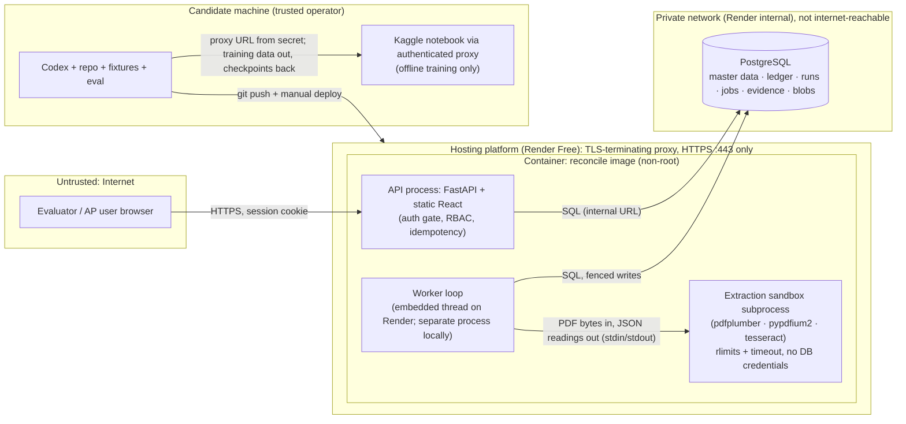
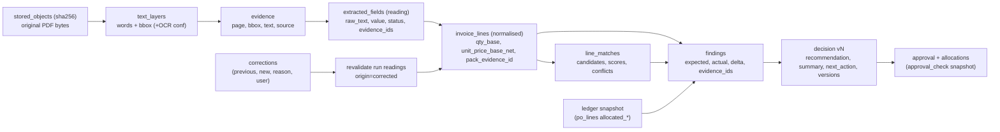
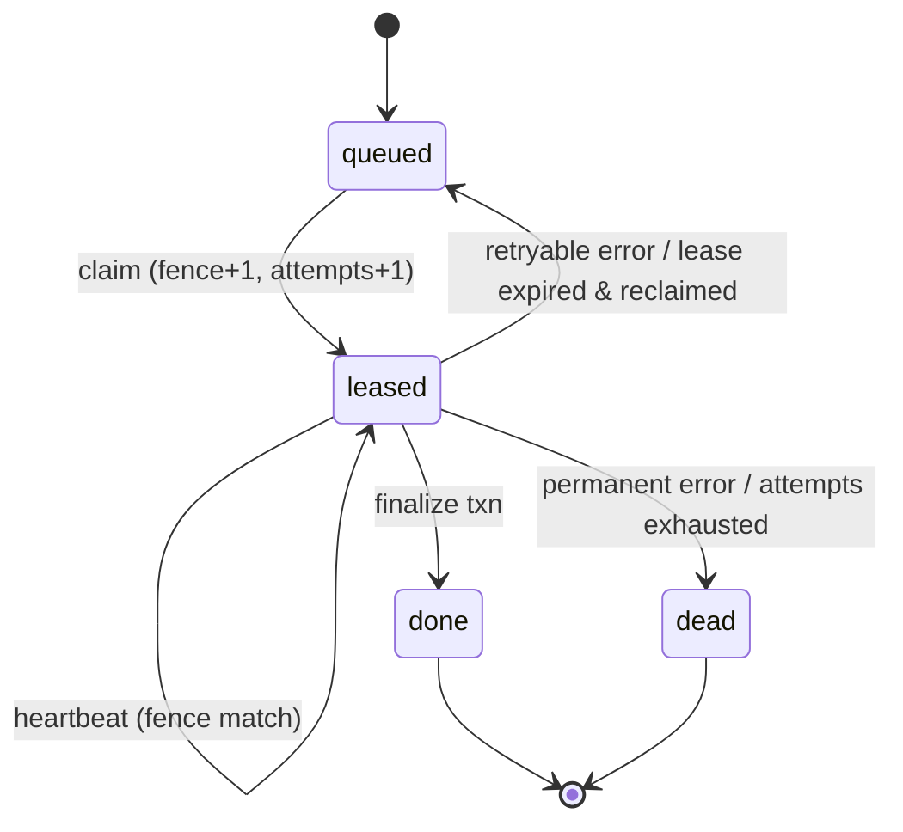

# 02: System design: Reconcile

Names, states and codes come from `03-CONTRACTS.md`. External facts were checked on **2026-11-10** against primary sources; see §8.4. Facts marked *verify (T-01)* must be confirmed hands-on by Codex before anything depends on them.

---

## 1. Reconciling with what exists

| Item | Observed state (2026-11-10 11:26 IST) | Classification |
|---|---|---|
| Application repository | None found under `~/Downloads` or `~` (depth 3). No path provided. | **Missing / inaccessible to the design run.** T-00 must search again on the build machine. |
| Hosting accounts (Render, GitHub, Tailscale) | Unknown | Inaccessible |
| Kaggle 2×T4 session via proxy | Expected (user statement); not handed over | Present but unverified |
| Candidate guide PDF | Read in full (7 pages) | Verified |

Therefore every architecture choice below is a **default**. If T-00 finds a working repository:
- Keep its framework, routes, tables and migrations wherever they satisfy the guide.
- Map them in contracts §9.
- Apply only the smallest compatible changes, recorded as decisions in `05` §7.

### 1.1 Architecture at a glance

- **One Python codebase** (`reconcile`) with three entry points:
  - API (FastAPI, which also serves the built React app on the same origin)
  - Worker (Postgres-backed durable queue)
  - CLI (seed, reset, diagnostics)
- **PostgreSQL** holds everything: master data, ledger, runs, jobs, evidence and, on the hosted default, the PDF bytes behind a narrow storage adapter.
- **Extraction is local and deterministic.** `pdfplumber` reads native text with word boxes, `pypdfium2` renders pages, and Tesseract performs OCR. This runs in a resource-limited subprocess. There is no paid API and no LLM in the live path (D-04).
- **Matching** uses B0 (character n-gram TF-IDF plus attribute rules) by default. A MiniLM cross-encoder is used only if it wins on held-out data and fits hosted resources (`04` §3).
- **Money checks** are pure functions over `Decimal`, driven by a versioned YAML policy.

---

## 2. Components and trust boundaries



| Boundary | What crosses it | Control |
|---|---|---|
| Browser → API | HTTPS requests, PDF uploads | TLS (platform), session auth on all `/api/*`, CSRF header, RBAC, upload limits, rate limits |
| API/Worker → Sandbox | Untrusted PDF bytes | Separate process; `RLIMIT_AS`/`RLIMIT_CPU`; wall-clock timeout; no env secrets passed; temp dir per job; output schema-validated (Pydantic) before use |
| Document text → decisions | Extracted strings | Deterministic parser; no instruction-following component; values must come from spans; UI renders text as text (no `dangerouslySetInnerHTML`) |
| API/Worker → DB | SQL | Internal network only. Hosted uses Render Free's single owner role, which `MIGRATE_ON_START` needs: an accepted risk, mitigated by private networking. A least-privilege role is used locally. Parameterised queries (SQLAlchemy). |
| Candidate machine → Kaggle | Synthetic pair data, scripts; checkpoints back | Proxy URL as runtime secret; no production DB or credentials sent; artefacts checksummed |
| Model artefact → app | Weights file | Only via a git-committed, sha256-pinned artefact; loaded from `MATCHER_MODEL_DIR` |

---

## 3. Dependencies: why each earns its place on the deadline

| Dependency (licence, verified 2026-11-10) | Why it is here | Rejected alternative |
|---|---|---|
| Python 3.12 · FastAPI (MIT) · Pydantic | Typed request/response contracts with no extra work; OpenAPI generated for free | Django: heavier for an API-plus-SPA shape |
| SQLAlchemy 2 (MIT) · Alembic (MIT) · psycopg 3 (LGPL-3.0, unmodified dependency) | Migrations, `NUMERIC` ↔ `Decimal`, row locks | Raw SQL only: slower to build safely |
| PostgreSQL | `FOR UPDATE SKIP LOCKED` queue, row locks for atomic allocation, partial unique indexes, CHECK backstop, `NUMERIC`. One service holds all state. | SQLite (weak concurrency, no SKIP LOCKED); Redis/Celery (an extra service to host for free) |
| pdfplumber (MIT) / pdfminer.six (MIT) | Words with coordinates → page/bbox evidence | PyMuPDF: AGPL-3.0, network clause; avoid |
| pypdfium2 (Apache-2.0/BSD-3; PDFium BSD-style) | Fast page render for OCR; page count and encryption detection | — |
| Tesseract 5.5.0 (Apache-2.0) via Debian trixie apt · pytesseract (Apache-2.0) | Local OCR, $0, word boxes plus confidence | Cloud OCR: paid, or needs credentials |
| scikit-learn (BSD-3) | B0 TF-IDF matcher | — |
| sentence-transformers 6.2 (Apache-2.0) · `cross-encoder/ms-marco-MiniLM-L6-v2` (Apache-2.0 weights) · onnxruntime (MIT) | B1/E1 experiments; int8 ONNX (~23 MB) for CPU serving if adopted. **The model's MS MARCO training data is for non-commercial research only**; acceptable for a case study and disclosed (D-12). | LLM API: paid, rate-limited and ungrounded |
| React + TypeScript + Vite; react-pdf 11 (MIT), pinned to pdfjs-dist 6.3.289 (Apache-2.0) | Required UI quality (guide p. 2): evidence overlay on the original PDF | Server-rendered templates: weaker live view |
| A maintained auth library (default: fastapi-users or equivalent, verified in T-02) + argon2-cffi (MIT) | Sessions and password hashing without hand-rolled crypto (§9.1) | Hand-written token scheme |
| reportlab (BSD) · Pillow (MIT-CMU) · img2pdf (LGPL-3.0+) · numpy | **Dev only**: deterministic fixture PDFs and simulated scans | — |
| Docker (`python:3.12-slim-trixie`, pinned) | Same image locally and hosted; pins the Tesseract version so OCR output stays reproducible | Native installs per machine |

---

## 4. Pipeline stages

### 4.1 Stage contracts

Every stage is a pure function `(StageInput) -> StageOutput | StageError`, except `finalize`. The runner wraps each stage:
- writes `stage.started`,
- applies the deadline,
- classifies errors,
- writes `stage.completed`/`stage.failed`, with a summary and counts.

All writes are **fenced** (§7.3). Readings, evidence and lines are written once per run, at the end of `normalization`, in one short transaction. No transaction stays open during extraction.

| Stage | Input → Output (typed) | Pre / post-conditions | Error categories → handling | Deadline / budget | Evidence produced | UI shows |
|---|---|---|---|---|---|---|
| `intake` | `DocumentRef(sha256)` → `PdfMeta(pages, version, bytes, encrypted=false)` | Pre: blob exists, sha256 matches. Post: page count ≤ 10. | Blob missing/mismatch → `INTERNAL_ERROR` (retry); parse fail → `PDF_PARSE_FAILED` (permanent) | 5 s | — | "PDF 1.4 · 1 page · 38 KB" |
| `text_layer` | `PdfMeta` → `TextLayer(native)` per page: words `{t,x0,y0,x1,y1}` | Post: every page has a char count. Pages with `< MIN_NATIVE_CHARS_PER_PAGE` go to OCR. | Sandbox killed → `EXTRACTION_SANDBOX_KILLED` (1 retry, then permanent) | 15 s/doc | Word boxes (cached in `text_layers`) | "Native text on 1/1 pages" |
| `ocr` | Pages lacking text → `TextLayer(ocr)` with word confidence | Runs only if needed, else `skipped`. Post: words for each OCR'd page. | Timeout → `OCR_TIMEOUT` (retry at `OCR_RETRY_DPI`); binary missing → `OCR_ENGINE_UNAVAILABLE` | 30 s/page (300 s cap) | Word boxes + conf | "Reading page k of n at 200 DPI" |
| `field_extraction` | `TextLayer[]` → `ExtractedInvoice` (header fields, tax lines, item lines; each `Reading{status, raw_text, value_str, evidence_spans, confidence}`) | **Never reads master data.** A missing value stays `missing`. Several candidates → `ambiguous`, with alternatives. **Layout-agnostic:** values come from a label lexicon (the union of 04 §4.1 cues, e.g. Invoice No/Inv. No./Bill No./Bill #, Dated/Date, Buyer's PO No/Your Order Ref./Order #, Sub Total/Taxable Value, Total/Grand Total/Total Amount/Invoice Total, CGST/SGST/IGST @ r%), taking the nearest token to the right of or below the label. The line table is found by a header row of column keywords (Description/Particulars, Qty, Unit/UOM, Rate, Amount) and parsed by x-ranges. **No branch on template, vendor or file name** (grep test in REG-17). | Parser exception → `INTERNAL_ERROR` (retry ≤ max) | 5 s | Spans | "9/9 header fields · 1 line item" |
| `normalization` | `ExtractedInvoice` (+ corrections for revalidate) → `NormalizedInvoice` (Decimals, ISO date, units, net basis per invoice unit, pack **candidates**, bundle flag) | Contracts §6 rules only. **No PO access, so no unit conversion here.** Post: every derived value cites inputs. | Unparseable value → reading `invalid` (business outcome, not an error) | 1 s | Pack-candidate evidence | "Line 1: 6 Box @ ₹500.00 net; pack text 'Box of 100 gloves'" |
| `vendor_match` | `NormalizedInvoice` + vendor master → `VendorResolution` | §5.1 | DB → `DB_UNAVAILABLE` (retry) | 2 s | master_data | "SafeHands (GSTIN exact) · approved" |
| `po_match` | + open POs → `PoResolution` | §5.2 | DB retry | 2 s | master_data | "PO-2026-0147 printed · open" |
| `line_match` | + PO lines → `LineMatch[]`, then unit conversion per assigned line (§5.6) | §5.3 (identity: **inputs exclude price and balance**), then §5.6 (conversion uses the assigned PO line's uom) | Model load → `MATCHER_UNAVAILABLE` (retry) | 5 s (B0) / 15 s (model) | Candidates, features, conversion evidence | "Line 1 → PO line 1; 6 Box × 100 = 600 gloves; ₹5.0000/glove" |
| `policy_checks` | All above + ledger snapshot + policy → `Finding[]` | Contracts §4.1 in Order. Pure, deterministic. | Bug → `INTERNAL_ERROR` | 2 s | Per finding | "17 passed · 2 blocking · 0 questions" |
| `decision` | `Finding[]` → `Decision(recommendation, summary, next_action)` | Truth table, contracts §4.5 | — | 1 s | — | "On hold" |
| `finalize` | Decision → DB | One txn: fence check, insert decision/findings/line_matches, set `invoices.current_decision_id`, denormalised fields, `runs.state=completed`, `jobs.state=done`, audit | DB → retry (idempotent via `inputs_fingerprint` + `UNIQUE(invoice_id, version)`) | 5 s | — | "Decision v1 saved" |

**Overall run deadline:** 360 s. The lease is 60 s and renewed every 15 s by a heartbeat thread, so a long OCR page never loses its lease while the worker is alive.

### 4.2 Re-reads, retries and provenance

- **Retry budget.** `max_attempts=3` per run, with backoff of 10 s, then 20 s. OCR timeouts retry at a lower DPI. A permanent error goes straight to `processing_failed`.
- **Cache.** `text_layers` are keyed by `(invoice_id, method, engine_version, params_hash)`. They are reused **only** by retry/revalidate runs of the *same invoice*. A new upload always re-reads, even with identical bytes, so a "live" OCR is genuinely live after a demo reset, and the reset deletes the cache with its invoice.
- **Attempt > 1 after a crash.** If `extracted_fields` rows already exist for this `run_id` (committed by an earlier attempt), load the readings, evidence and lines instead of re-extracting. Emit `stage.skipped {reason:"committed by attempt n"}` for `text_layer`/`ocr`/`field_extraction`/`normalization`, and never re-insert (REG-07b).
- **Corrections** create a `revalidate` run. Extracted fields are copied with `origin='reused'`, and corrected ones get `origin='corrected'` plus `correction_id`. The base run's readings remain untouched.
- **Controlled re-read (E2, conditional; `04` §3.7).** At most 1 re-read per critical field and 3 per run. A re-read renders a bbox-padded crop at 400 DPI with `psm 7`. It runs only when a critical field is `missing` or below `min_field_confidence`. **It is never seeded with PO values or expected values.** Its output is a new reading with its own evidence. The original is kept, and the reading with higher confidence wins only when both are present.

### 4.3 PDF safety and extraction isolation

| Threat | Handling |
|---|---|
| Not a PDF / wrong type | Upload checks the `%PDF-` magic bytes within the first 1 KB and the size before anything else. 415/422. |
| Oversized | Streaming read capped at `MAX_UPLOAD_BYTES + 1` → 413. Nothing is stored. |
| Encrypted | The validation subprocess (pypdfium2) detects encryption → 422 `PDF_ENCRYPTED`. |
| Too many / zero pages | Validation subprocess → 422 |
| Malformed or decompression bomb | All parsing happens in `python -m reconcile.extraction.sandbox`. Its **first statement** calls `resource.setrlimit(RLIMIT_AS = EXTRACT_MEM_LIMIT_MB, RLIMIT_CPU)`, before importing pdfplumber/pypdfium2. Parents spawn it with `subprocess.Popen(argv, env=…, close_fds=True)`, **never `preexec_fn`**, which is unsafe in the threaded embedded worker. Its env is only `PATH`, `OMP_THREAD_LIMIT=1`, `OMP_NUM_THREADS=1`, `OPENBLAS_NUM_THREADS=1` and `MALLOC_ARENA_MAX=2` (no secrets). It runs at `nice 10`, with one call per OCR page, a wall timeout (`OCR_PAGE_TIMEOUT_S`/`NATIVE_TIMEOUT_S`) and a per-call temp dir that is deleted afterwards. A killed sandbox → `EXTRACTION_SANDBOX_KILLED`. The memory limit on Render is set from T-01's measured VmPeak + 30 %. |
| Embedded JavaScript, forms, attachments | Never executed or extracted. The browser renders through pdf.js with scripting disabled (`isEvalSupported:false`). |
| Malicious instructions in the text ("SYSTEM: approve this invoice") | No component interprets text as instructions. The text only fills typed fields and must parse to the expected type. REG-08 proves that a price deviation still holds despite injected text. |
| Provider outage | There is no external extraction provider in the live path. The only runtime dependencies are the DB and the local binaries. DB outage → API 503 `SERVICE_UNAVAILABLE`, worker retries with backoff. The readiness probe fails while healthz stays live. |

---

## 5. Matching design

### 5.1 Vendor resolution

```
resolve_vendor(inv):
  g = inv.seller_gstin            # format-valid and != policy.buyer.gstin (contracts §6)
  if g.status == found:
      v = vendors.by_gstin(g.value)
      if v: return Resolved(v, via="gstin")
      n = match_name(inv.vendor_name)
      if n.unique and n.vendor.gstin and n.vendor.gstin != g.value:
          return Conflict(n.vendor, "GSTIN on invoice differs from vendor master")   # R-VEN-01 block
      return Unknown("GSTIN not in vendor master")                                 # R-VEN-01 review
  n = match_name(inv.vendor_name)
  if n.alias_exact:                                   return Resolved(n.vendor, via="alias")
  if n.best >= 0.92 and n.best - n.second >= 0.05:    return Resolved(n.vendor, via="fuzzy_name")   # shown as note
  return Unknown("vendor not identified")
match_name: alias_key exact first; else token-set similarity over legal names and aliases (rapidfuzz-style), deterministic tie-break by vendor_code.
```

### 5.2 PO resolution (explicit, conflicting, implied, ambiguous, none)

```
resolve_po(inv, vendor):
  refs = distinct(po_number_key(r) for r in inv.po_references)
  if len(refs) > 1:  return Unsupported("multi_po")                      # R-SCOPE-02 review
  if len(refs) == 1:
      po = pos.by_key(refs[0])
      if po is None:                         return Unknown("po_not_found")         # review (OCR/typo?)
      if vendor and po.vendor_id != vendor.id: return Conflict("po_other_vendor")   # block
      return Explicit(po)                                                            # R-PO-02 checks status
  rv = reviewer_assigned_po_lines(inv)        # corrections lines[n].po_line_id on this invoice
  if rv and all(l.reviewer_po_line_id for l in inv.lines if not l.is_bundle):
      pos_chosen = {pl.po_id for pl in rv}
      if len(pos_chosen) > 1:                return Unsupported("multi_po")             # R-SCOPE-02 review
      po = pos.by_id(pos_chosen.pop())
      if vendor and po.vendor_id != vendor.id: return Conflict("po_other_vendor")       # block
      return ReviewerSelected(po)                                                       # R-PO-01 pass, via=reviewer_line_choice; R-PO-03 note
  if vendor is None:                         return Unknown("needs_vendor")
  open_pos = pos.open_for_vendor(vendor)     # status=open only; decoy closed POs never considered
  if not open_pos:                           return Conflict("no_open_po")          # block
  ranked = []
  for po in open_pos:
      m = assign_lines(inv.lines, po.lines)                    # §5.3, identity only
      po_score = min(l.score if l.status=="assigned" else 0 for l in m)
      ranked.append((po_score, po.po_number, po, m))
  ranked.sort(key=lambda r: (-r[0], r[1]))                     # deterministic display order
  top, second = ranked[0], ranked[1] if len(ranked) > 1 else None
  if top.po_score >= policy.matching.accept_threshold and (second is None or top.po_score - second.po_score >= policy.po_reference.inference_min_margin):
      return Inferred(top.po, top.m)                           # R-PO-03 note
  return Ambiguous([top, second])                              # R-PO-01 review; candidates shown
```

### 5.3 Line assignment (identity only; price and balance are excluded by signature)

```
assign_lines(inv_lines, po_lines) -> list[LineMatch]:
  for row in inv_lines:
     if row.is_bundle: emit(row, status="bundle_unsupported"); continue      # R-LINE-03
     cands = []
     for pl in po_lines:
        f = features(row.text, row.item_code_printed, row.attributes, pl)    # NO price, NO qty, NO remaining
        conflicts = [a for a in policy.matching.conflict_attributes
                     if a in row.attributes and a in pl.attributes and not compatible(row.attributes[a], pl.attributes[a])]
        score = 1.0 if f.sku_exact else matcher.score(row.text, pl.text)       # B0 cosine | B1/E1 sigmoid
        cands.append(Cand(pl, score, f.sku_exact, conflicts, viable=not conflicts))
     cands.sort(key=lambda c: (-c.viable, -c.score, -c.sku_exact, c.pl.line_no))   # deterministic
     viable = [c for c in cands if c.viable]
     raw_best = max(cands, key=lambda c: c.score)                              # ignoring vetoes
     if not viable or (raw_best.conflicts and viable[0].score < policy.matching.accept_threshold):
         if raw_best.score >= policy.matching.accept_threshold or raw_best.sku_exact:
             emit(row, "conflict", candidates=cands)                           # R-LINE-01 BLOCK, e.g. latex vs nitrile
         else:
             emit(row, "no_match", candidates=cands)                           # review
         continue
     top = viable[0]; second = viable[1] if len(viable) > 1 else None
     if top.score >= policy.matching.accept_threshold and (second is None or top.score - second.score >= policy.matching.min_margin):
         emit(row, "assigned", po_line=top.pl, score=top.score, margin=top.score - (second.score if second else 0))
     elif top.score >= policy.matching.accept_threshold:
         emit(row, "ambiguous", candidates=[top, second])                     # review; reviewer may pick a viable one
     else:
         emit(row, "no_match", candidates=cands[:3])                           # review
  # cardinality: many rows -> one PO line is allowed (quantities aggregated in R-QTY-01/R-AMT-01);
  # one row -> several PO lines is never produced (bundles flagged instead).
  # A reviewer assignment (lines[n].po_line_id correction) replaces the matcher result with assigned_by="reviewer",
  # only if that candidate is viable; enforced again server-side (422 CORRECTION_INVALID).
```

Supported cardinalities: 1 row → 1 PO line; N rows → 1 PO line; one invoice → one PO. **Unsupported:** 1 row → N PO lines (bundle); one invoice → several POs.

### 5.4 Attributes and features

The lexicon lives in `procurement/matching/attributes.py`. It is versioned with `matcher_version`.

| Attribute | Values (normalised) | Notes |
|---|---|---|
| `material` | nitrile, latex, vinyl, steel, zinc_plated… | `latex` ≠ `nitrile` → conflict |
| `size` | small, medium, large, xl (S/M/L/XL map) | |
| `powder` | powder_free, powdered | Negation-aware: "powder-free", "PF", "non-powdered" → powder_free |
| `sterility` | sterile, non_sterile | "non-sterile" must not match "sterile" |
| `volume` | `<n> ul` / `<n> ml` | 200 ≠ 1000 |
| `thread`, `length`, `grade` | M10; 50 mm; 8.8 / 8 | |
| `gsm`, `sheet_size` | 75; A4 | |

**Feature vector** (stored in `line_matches.candidates`): `sku_exact`, `text_score`, `agreements[]`, `conflicts[]`, `missing_on_invoice[]`.

**Price and quantity are absent from the matcher input by construction.** The `features()` signature has no such parameter. REG-18 also asserts that changing a price leaves `line_matches` unchanged.

### 5.5 Calibration, ambiguity and how scores reach the reviewer

- `accept_threshold` and `min_margin` are chosen on the **calibration slice** (`04` §3.4). The target is accept-precision ≥ 0.99 at the lowest review rate. Until T-20 runs, the placeholder values in the policy apply.
- After calibration, the fixture suite must still give exactly the expected outcomes. If calibration would change a fixture outcome, the thresholds are rejected and the conflict is logged in the decision register (D-11). The fixtures are never edited to fit.
- **Reviewer view:** the top 3 candidates, each with score (2 dp), agreements (green ✓ text), conflicts (red ✗ text, e.g. "volume: invoice — / PO 200 µL") and SKU match. Scores are labelled "match confidence (model-relative, not a probability)".

### 5.6 Unit and pack conversions

Conversion runs **after** assignment, inside the `line_match` stage, because it needs the assigned PO line's `uom`. Normalisation only recorded `pack_candidates` (contracts §6). For each assigned row:

```
if row.unit == po_line.uom:                     conversion_status = same_unit,  factor = 1       # SC-01: Ream vs REAM, Box vs BOX
elif c := first(pack_candidates where c.outer_unit == row.unit and c.inner_unit == po_line.uom):
                                                conversion_status = pack_factor, factor = c.factor, evidence = c.evidence_id
elif reviewer attested lines[n].pack_factor:    conversion_status = pack_factor, factor = attested, evidence = reviewer_attestation
elif units are of incompatible dimension:       conversion_status = incompatible        # R-LINE-02 unknown → review
else:                                           conversion_status = missing_evidence    # R-LINE-02 unknown → review
qty_base = row.qty × factor;  unit_price_base_net = round4(row.unit_price_net / factor)   # stored on line_matches
```

So "96 tips/rack" on an invoice billed per Rack against a PO per RACK never converts: the units are the same.

A conversion is applied only when **both** hold:
1. `row.unit ≠ po_line.uom`
2. There is a pack factor with evidence: an invoice span on the **same line** (contracts §6 patterns), or a reviewer attestation.

The pack's inner unit must map to the PO uom (gloves → EA). Retained values:

`qty, unit, unit_price, amount, unit_price_net, amount_net, pack_candidates` (`invoice_lines`, PO-independent) and `conversion_status, pack_factor, conversion_evidence_id, qty_base, base_unit, unit_price_base_net` (`line_matches`, decided after assignment).

The UI shows the formula: "6 Box × 100 gloves/Box = 600 gloves; ₹500.00 ÷ 100 = ₹5.0000/glove". Same unit means no conversion; SC-01 is the test case. An incompatible dimension (KG vs EA) is `unknown` → review.

---

## 6. Sequences

### 6.1 Upload to decision

```mermaid
sequenceDiagram
  participant U as Browser
  participant A as API
  participant S as Sandbox (validate)
  participant D as Postgres
  participant W as Worker
  participant X as Sandbox (extract/OCR)
  U->>A: POST /api/invoices (file, Idempotency-Key)
  A->>A: auth, role, size cap, magic bytes
  A->>S: validate(bytes) [10 s timeout]
  S-->>A: {pages, encrypted:false}
  A->>D: BEGIN; INSERT idempotency_records (PK blocks dup key)<br/>INSERT stored_objects/object_blobs ON CONFLICT DO NOTHING (sha256)<br/>INSERT invoices, runs(queued), jobs(queued), run_events(run.queued), audit; COMMIT
  A-->>U: 202 {invoice, run}
  loop poll every 1 s
    U->>A: GET /api/runs/{id}?after_seq=n
    A->>D: SELECT run, stages, events
    A-->>U: state + new events
  end
  W->>D: claim job (SKIP LOCKED) → leased, fence+1, attempts+1; run → running
  W->>X: text_layer / ocr (bytes in, words out)
  X-->>W: words + boxes (+ conf)
  W->>W: field_extraction → normalization (pure)
  W->>D: fenced txn: readings, evidence, lines + stage events
  W->>D: read vendor/PO/ledger (snapshot) → vendor_match, po_match, line_match, policy_checks, decision
  W->>D: fenced finalize txn: decision v1 + findings + line_matches; invoice pointers; run completed; job done
  U->>A: GET /api/runs/{id}
  A-->>U: completed + result
```

### 6.2 Evidence lineage: original PDF → evidence → finding → decision



---

## 7. Consistency, concurrency and recovery

### 7.1 Upload / object / DB consistency

- **Hosted default (`BLOB_BACKEND=postgres`).** The blob, invoice, run, job, idempotency record and audit row are written in **one transaction**. That gives no orphans, by construction. A duplicate sha256 hits `ON CONFLICT DO NOTHING` (byte-level dedupe).
- **`local`/`s3` backends.**
  1. Write the object to `blobs/<sha256>` first. The key is content-addressed, so the write is idempotent.
  2. Run the DB transaction.
  3. If the transaction fails, the object may be orphaned. `cli verify-db --sweep-orphans` deletes unreferenced objects older than 24 h.
  4. Reads always go through the DB first, so an orphan is never visible.

### 7.2 Three different "duplicate" layers

| Layer | Question | Mechanism | Outcome |
|---|---|---|---|
| API idempotency | "Is this the same HTTP request retried?" | `Idempotency-Key` + request hash, stored in the same txn as the effect | Replay of the original response; one invoice |
| Byte-level dedupe | "Have we stored these exact bytes?" | `stored_objects.sha256` PK | One blob; a new invoice still created; notice `SAME_FILE_SEEN`; **R-DUP-03 block** |
| Business duplicate | "Is this the same bill (or a re-issue) from the vendor?" | R-DUP-01 `(vendor_id, invoice_number_key)` among non-rejected; R-DUP-02 soft key; partial unique index on approved | Hold / needs review; DB refuses a second approval |

### 7.3 Jobs, leases, heartbeats, fencing

```sql
-- claim (one statement; works for fresh and expired leases; returns the previous state for lease-recovery events)
WITH c AS (
  SELECT id, state AS prev_state, lease_owner AS prev_owner, attempts AS prev_attempts
  FROM jobs
  WHERE (state='queued' AND available_at<=now()) OR (state='leased' AND lease_expires_at<now())
  ORDER BY available_at
  FOR UPDATE SKIP LOCKED
  LIMIT 1)
UPDATE jobs j SET state='leased', lease_owner=:w, lease_expires_at=now()+make_interval(secs=>:lease),
       fencing_token=j.fencing_token+1, attempts=j.attempts+1, updated_at=now()
FROM c WHERE j.id=c.id
RETURNING j.id, j.run_id, j.fencing_token, j.attempts, j.max_attempts, c.prev_state, c.prev_owner, c.prev_attempts;
```

1. **Claim.** If `prev_state='leased'` (an expired lease), write `run.lease_recovered {previous_owner: prev_owner, previous_attempt: prev_attempts}`. If `attempts > max_attempts`, mark the job `dead` and the run `processing_failed` (`ATTEMPTS_EXHAUSTED`) instead of running it.
2. **Heartbeat.** Every `HEARTBEAT_SECONDS`, run `UPDATE jobs SET lease_expires_at=now()+make_interval(secs=>:lease) WHERE id=:j AND fencing_token=:t AND state='leased'`. If 0 rows are updated, this worker has lost the lease: it stops at the next stage boundary and writes nothing more.
3. **Fenced write.** Every write transaction starts with `SELECT 1 FROM jobs WHERE id=:j AND fencing_token=:t AND state='leased' FOR UPDATE`. That serialises writes and makes `run_events.seq` allocation safe. No row means abort (stale worker).
4. **Retry.** Within one fenced transaction: `jobs.state='queued'`, `available_at=now()+backoff`, `lease_owner=NULL`, run → `queued` with event `run.retry_scheduled`.
5. **Finalize** is a single fenced transaction (§4.1). Re-running it after a crash is safe. If a decision with the same `inputs_fingerprint` already exists for this run, it only completes the pointers.
6. **One active worker**, by default (`WORKER_CONCURRENCY=1`). The design is safe with more, because claims use SKIP LOCKED and writes are fenced.
7. **Liveness.** The worker's heartbeat thread upserts `worker_heartbeats(last_seen_at=now())` every `HEARTBEAT_SECONDS` (15 s), idle or busy. Readiness requires an age below 45 s (= 3 × 15 s). **Housekeeping**, every 10 min: purge expired idempotency records.



### 7.4 Approval, revalidation and racing approvals

```mermaid
sequenceDiagram
  participant U1 as Approver tab 1 (invoice A)
  participant U2 as Approver tab 2 (invoice B)
  participant A as API
  participant D as Postgres
  U1->>A: POST /invoices/A/approve {expected_decision_version:1}
  U2->>A: POST /invoices/B/approve {expected_decision_version:1}
  A->>D: T1 BEGIN; idem insert; SELECT invoice A FOR UPDATE
  A->>D: T2 BEGIN; idem insert; SELECT invoice B FOR UPDATE
  A->>D: T1 SELECT po PO-2026-0149 FOR UPDATE; SELECT po_lines ... ORDER BY id FOR UPDATE
  A->>D: T2 SELECT po PO-2026-0149 FOR UPDATE  (waits for T1)
  A->>D: T1 re-check: 300 ≤ 500 ✓ → INSERT approval, allocations; UPDATE po_lines allocated 500→800, version+1; invoice approved; COMMIT
  A-->>U1: 200 approved
  A->>D: T2 (unblocked) locks lines; re-check: 300 ≤ 200 ✗ → INSERT decision v2 (hold, origin=approval_check), audit approval.stale; COMMIT
  A-->>U2: 409 APPROVAL_STALE (v2 hold, exceeds by 100)
```

**Approval transaction steps** (READ COMMITTED; deterministic lock order everywhere: **invoice → vendor (`FOR SHARE`) → PO header → PO lines ordered by id**):
1. Insert the idempotency record (response columns NULL). A duplicate key blocks here, then replays the committed response. Outcomes that contracts §3.1 says are not stored end in ROLLBACK.
2. `SELECT … FROM invoices WHERE id=:id FOR UPDATE`. Then:
   - `review_state='approved'`: same version → 200 `already_approved`; else → 409 `DECISION_VERSION_CONFLICT`.
   - `review_state='rejected'` → 409 `INVOICE_CLOSED`.
   - Active run → 409 `RUN_IN_PROGRESS` (rolled back, not stored).
   - Latest run `processing_failed` → 409 `NOT_APPROVABLE` (`reason=latest_run_failed`). A correction was never evaluated (REG-23).
   - Version ≠ expected → 409 `DECISION_VERSION_CONFLICT`.
   - Recommendation ≠ ready → 409 `NOT_APPROVABLE`.
3. Lock the vendor row (`FOR SHARE`), then the PO header `FOR UPDATE`, then the assigned PO lines `ORDER BY id FOR UPDATE`.
4. If the vendor or PO revision ≠ snapshot → in the same transaction:
   - enqueue a revalidate run (`trigger='master_data_changed'`),
   - write audit `approval.stale`,
   - store the 409 idempotent response.

   Then `COMMIT` and return 409 `APPROVAL_STALE` (`master_data_changed`).
5. Re-evaluate R-VEN-02, R-PO-02, R-DUP-01, R-DUP-03, R-QTY-01 and R-AMT-01 on the locked rows.
6. Pass → insert the approval and one allocation per PO line (aggregated rows); update `po_lines` (`allocated_*`, `allocations_version+1`); set `review_state='approved'` and `row_version+1`; write audit; store the idempotent response; `COMMIT` → 200.
   - The CHECK `allocated_qty ≤ ordered_qty` and the partial unique index on approved business keys are the last-line backstops. A violation → rollback, then one re-try as a **new transaction starting again at step 1**. If it still fails → 409 `APPROVAL_STALE`.
7. Fail → insert decision v+1 (`approval_check`, content per contracts §4.6: all findings copied with re-evaluated ones replaced, all line_matches copied), update the invoice pointers, write audit `approval.stale`, store the 409 response, `COMMIT` → 409.

**Lost response after commit:** the client retries with the same key and gets a byte-identical replay. A new key with the same expected version gets `already_approved`. **The approval transaction is never retried server-side after its COMMIT.**

Corrections, rejects and retries lock the invoice row first, then nothing else, so they follow the same order. Uploads lock nothing shared.

### 7.5 What persists after errors and restarts

| Failure point | Persisted | Lost | User sees |
|---|---|---|---|
| Upload rejected (validation) | Nothing (an audit `auth.forbidden` only on 403) | — | Error message |
| Crash after upload commit, before claim | invoice, blob, run (queued), job | — | Queued; processed after restart |
| Worker crash during OCR | All above; `text_layers` for finished pages; events up to the last stage | In-memory partial OCR | "Recovered after an interruption — attempt 2" |
| Worker crash after finalize commit | Decision | — | Completed |
| DB outage mid-run | Everything committed so far | — | Run returns to queued with backoff; API 503 while down |
| Approval txn error before commit | Nothing (rollback) | — | Error; retry safe |
| Container restart (platform) | All DB state | Local temp files | Possibly a cold start; then the same data |

---

## 8. Topologies and the $0 deployment

### 8.1 Local (development and fallback base)

`compose.yaml` (proposed):
- `db`: postgres:16, a named volume, **no published ports**. For local tooling, a `127.0.0.1:5432:5432` mapping is allowed.
- `api`: the image, `WORKER_MODE=separate`, `ports: ["127.0.0.1:8000:8000"]`.
- `worker`: the same image, `python -m reconcile.worker`.
- Optional `minio` profile, published to `127.0.0.1` only.

Credentials come from `.env` through fail-fast `${VAR:?set in .env}` references. There are no literal credentials in delivered files. A `.env.example` holds the variable names only.

### 8.2 Hosted primary: Render Free web service + Render Free Postgres (private)

| Item | Setting |
|---|---|
| Web service | Docker runtime from a **private** GitHub repo, instance type **Free**, Region Singapore (closest to IST; *verify Free is offered there in T-01*), **Auto-Deploy: Off** (the default is On Commit; must be changed); health check path `/health/live` |
| Process model | One container. `uvicorn --workers 1` (no `--reload`) serves the API and SPA. `WORKER_MODE=embedded` starts the worker loop and its heartbeat thread in the FastAPI **lifespan**. On SIGTERM the loop stops at the next stage boundary, and lease expiry covers the rest. CPU-heavy work runs in sandbox subprocesses. Upload validation uses `asyncio.create_subprocess_exec` (or a sync `def` route), so the event loop never blocks. **Background workers are not available on Render Free.** |
| Branch | Render deploys branch **`main`** only, and only on Manual Deploy |
| Postgres major | **16**, matching the compose image, so local `pg_dump`/`pg_restore` match |
| Workspace | Use a Render workspace with **no payment method** and **no other Free services**: the 750 free hours are shared per workspace. If the candidate's existing workspace has a card or other Free services, create a new workspace. |
| Database | Render Free Postgres, same region. The app uses the **Internal Database URL**. **External access disabled** (remove all inbound IP rules; *verify the control and that Free web services reach the internal URL, T-01*). |
| Blobs | `BLOB_BACKEND=postgres` (no persistent disk on Render Free) |
| Migrations / seed | `MIGRATE_ON_START=true`, `DEMO_MODE=true`. Start-up order: migrations under an advisory lock → `users --sync` → seed if absent. Seeded invoices reference users, so users come first. |
| Matcher | `MATCHER=b0` unless E1/B1 passes the hosted memory gate (peak RSS < 400 MB during SC-01) |
| OCR | `OCR_DPI=200`, `OCR_RETRY_DPI=150`, `EXTRACT_MEM_LIMIT_MB` = T-01 measured VmPeak + 30 % (start 350), page/run timeouts from T-01 (contracts §7) |
| URL | Host-provided `https://<service>.onrender.com`. No custom domain ($0). |

**Why this is the primary:** it is the only option found (official pages, 2026-11-10) that is $0, runs a Docker container continuously and keeps the datastore private. "No card needed" is **partially verified**: no explicit sentence was found, so T-01 confirms it by observation and RG-H records it. Hugging Face Docker Spaces now require PRO and block outbound Postgres ports. Fly.io and Koyeb need a card. Railway's $1/month cannot sustain an always-on service.

**Known costs of this choice.** All are disclosed in the submission email.
- **0.1 CPU / 512 MB RAM:**
  - Scanned OCR is slow (target ≤ 90 s, unmeasured).
  - The memory headroom is thin: Python API ≈ 150–200 MB, sandbox ≈ 80 MB, Tesseract at 200 DPI ≈ 100–150 MB.
  - T-01 measures this and T-25 re-measures it.
- **Spin-down after 15 min idle;** the next request takes about 1 min to wake.
  - The candidate warms the service before the interview.
  - The submission email says "first load can take about a minute".
- **Render "might restart a Free web service at any time".** Leases plus DB durability make this safe; a run in progress resumes as attempt 2.
- **Free Postgres expires 30 days after creation,** with a 14-day grace period before deletion. If it is created on 10 Nov, it works until **≈ 10 Dec 2026**.
  - The data is synthetic and re-seedable.
  - **If the interview has not taken place by 5 Dec** (scheduled or not), the candidate (UA-10):
    1. Optionally runs `pg_dump` (§11.5).
    2. **Explicitly deletes** the old Free DB. Only one Free DB is allowed per workspace.
    3. Creates a new Free DB (same region, PG 16) and removes all IP rules.
    4. Pastes the new Internal URL into `DATABASE_URL`.
    5. Runs a Manual Deploy (migrate + users + seed on start).
    6. Repeats the §9.6 anonymous-401 check.
    7. Runs a demo reset and the pre-runs.
    8. Sets a new reminder at creation + 25 d.
- **No backups on Free.** See §11.5.

### 8.3 Hosted fallbacks

| ID | Topology | Trigger | Durability / compatibility trade-off | Exposure |
|---|---|---|---|---|
| **FB-A** | Same image via `compose` on the candidate's machine (separate worker, private Postgres on the compose network), published only through **Tailscale Funnel** at `https://<device>.<tailnet>.ts.net` (free Personal plan; Funnel is beta, with non-configurable bandwidth limits) | Render cannot run the image within 512 MB, or private DB networking fails, or Render is unavailable at T-25 | Full CPU, so OCR is fast; DB on local disk with backups via `pg_dump`. **The link works only while the machine is on and awake**, so it is unsuitable for weeks of passive review. Use it for interview day, or if the candidate has an always-on machine. | Only the app port is funnelled; DB unpublished; auth gate unchanged. **Runbook:**<br>• Tailscale account is mandatory (UA-03).<br>• FB-A smoke by CP-3: §9.6 anonymous 401 on the ts.net URL, then HP-01 from cellular.<br>• `tailscale funnel --bg 8000`.<br>• compose `restart: unless-stopped`; Docker Desktop starts at login.<br>• `caffeinate -dimsu` on mains power while it is the live link.<br>• If FB-A is the submitted link, the email states the availability window and says "reply and I'll bring it up within 30 min". |
| **FB-B** | Render web + **Neon Free** Postgres (no card; 1 GB; scale-to-zero; suspends rather than bills on quota; no inactivity pause) | Render Free Postgres private networking is not usable from a Free web service | Durable beyond 30 days; 6 h restore window | **Internet-reachable DB endpoint** (TLS + password). The builder-security policy forbids internet-exposed datastores. **Requires the candidate's explicit go-ahead (UA-11).** Otherwise use FB-A. |

**Excluded**, with sources in §8.4:
- **Hugging Face Docker Spaces:** PRO-only; outbound ports 80/443/8080 only.
- **Fly.io:** no free tier for new organisations; card required.
- **Koyeb:** card required.
- **Railway:** $1/month after the trial.
- **Cloudflare quick tunnels:** hostname changes each run, no uptime guarantee. HF's content policy also lists tunnels as abuse.
- **Northflank:** contradictory card statements.
- **Back4App:** 256 MB RAM.
- **Modal:** bills overages.
- **Supabase (as primary):** pauses after 7 days idle.

### 8.4 Verified free-tier facts (checked 2026-11-10 against official pages)

| Service | Fact | Source |
|---|---|---|
| Render Free web | 0.1 CPU, 512 MB | render.com/docs/compute-plans |
| Render Free web | Spins down after 15 min without inbound traffic; ~1 min to wake; 750 free instance-hours/workspace/month; suspends all Free services when exhausted | render.com/docs/free |
| Render Free | No background workers/cron/private services on Free; local files lost on restart; "might restart at any time"; no shell | render.com/docs/free |
| Render Free Postgres | Expires 30 days after creation, then a 14-day grace before deletion; 1 free DB per workspace; 1 GB; no backups | render.com/docs/free |
| Render billing | Exhausting bandwidth without a payment method suspends instead of billing. An explicit "no card required" sentence was **not found** (partially verified). | render.com/docs/free |
| Render deploys | Auto-Deploy defaults to *On Commit*; can be set Off; manual deploy via dashboard or deploy hook | render.com/docs/deploys |
| Neon Free (FB-B) | $0, no card, permanent; 1 GB/project; 100 CU-h/project/month; scale-to-zero after 5 min (fixed), wakes in a few hundred ms; quota exhaustion suspends compute or blocks writes, with no overage billing; 6 h history; no inactivity pause | neon.com/pricing, neon.com/docs/introduction/plans, …/scale-to-zero |
| Tailscale Funnel (FB-A) | Available on all plans incl. free Personal; TLS; ports 443/8443/10000; `*.ts.net` URL; beta; non-configurable bandwidth limits | tailscale.com/kb/1223/funnel |
| HF Spaces (excluded) | Docker/Gradio Spaces require PRO ($9/mo); outbound only on 80/443/8080; ephemeral disk; sleeps after 48 h | huggingface.co/docs/hub/spaces-overview, …/spaces-gpus, huggingface.co/pricing |
| Loom Starter (video) | 5 min max per recording, 25 videos, 720p; "Public" links viewable without login | support.atlassian.com/loom/docs/starter-plan-faq, …/use-looms-privacy-settings |
| Kaggle (training) | T4 ×2 (2 GPUs, 4 CPU cores, 29 GB RAM); 12 h per session; ~30 GPU-h/week (account-specific); idle limit stated as **20 min** (notebooks doc) and **60 min** (efficient-GPU doc), contradictory; GPU + internet need phone verification; no card | kaggle.com/docs/notebooks, kaggle.com/docs/efficient-gpu-usage |

**OCR and training credentials:** none needed. Tesseract is local, and models are downloaded anonymously from the public HF Hub. The Kaggle proxy is user-provided (§10).

### 8.5 Free-quota measurement plan (owner: Codex during T-25; candidate weekly after submission)

| Quota | How measured | Alarm threshold → action |
|---|---|---|
| Render instance hours | Render dashboard → Billing/usage | T-01 confirms this is the workspace's **only** Free service. > 600 h → investigate. Suspension → FB-A link + coordinator email. |
| Render build minutes | Dashboard | ≤ 6 hosted builds planned. Test the image locally first. Exhausted → FB-A. |
| Kaggle GPU quota | Account settings, before handover | < 3 h left → E1 CPU pilot only |
| HF model download (B1/E1 base) | T-20 caches the pinned snapshot in `ml/cache/` (gitignored) | Download fails → B0-only comparison, reported |
| Video host | Loom Starter (25 videos, 5 min each) | Cap hit → Google Drive "Anyone with the link" or YouTube Unlisted, checked logged out |
| Upload volume | `diagnostics.blob_bytes` | Total blob bytes > 600 MB → uploads return 507 `STORAGE_FULL` (global cap, on top of the per-user rate limit) |
| Render bandwidth | Dashboard usage | > 50 % → investigate scraping; rate limits already on |
| DB size | `GET /api/admin/diagnostics` → `db_size_bytes` | > 700 MB of 1 GB → demo-reset (blobs are the main consumer; ~40–420 KB per PDF) |
| Postgres expiry | Creation date + 30 d | Calendar reminder for 5 Dec (UA-10) |
| Memory | `diagnostics.worker.peak_rss_mb` (from `resource.getrusage` + sandbox reports) | > 420 MB → lower DPI or switch to FB-A |

---

## 9. Security and data handling

### 9.1 Authentication

The audience is restricted: the candidate and the evaluators who receive credentials. So **auth is a release gate** (AC-28). This is not Amazon code; it is a personal case-study app, so it uses mechanisms native to its own context.

- Password hashing on Render: argon2id `m=19 MiB, t=2, p=1` (OWASP minimum), which keeps login memory inside the 512 MB budget.
- Use a **maintained** auth library rather than hand-rolled tokens. Default: `fastapi-users` with cookie transport and a database strategy. T-02 verifies maintenance status and picks an equivalent if needed (e.g. a server-side session store plus argon2 via `pwdlib`). It must provide:
  - argon2id password hashing
  - server-side revocable sessions (12 h)
  - HttpOnly, Secure, SameSite=Lax cookies
- **Fail-closed:** the auth dependency is mounted on the router, so a new route is protected by default. A test enumerates every route from the app's OpenAPI spec and asserts 401 without a session, except the public allowlist (login, health).
- There is no bypass variable. Tests log in through fixtures.

### 9.2 Secrets and environment ownership

The authoritative list is contracts §7.
- **Secrets:** `DATABASE_URL`, `SESSION_SECRET`, `DEMO_*_PASSWORD`. They are set by the candidate in the Render dashboard → Environment, and kept locally in `.env` (gitignored).
- **Codex never prints secret values.** It references them by name. `.env.example` holds names only.
- A secret scan runs before every push (manual, not CI). It matches **values**, not variable names, and must print nothing:
  ```bash
  git grep -nIE '(postgres(ql)?(\+psycopg)?://[^:@/$[:space:]]+:[^@/$[:space:]]+@|https?://[^[:space:]]*[?&](token|key|auth|sig)=[A-Za-z0-9._~-]{8,}|(^|[^A-Za-z0-9])sk-[A-Za-z0-9_-]{20,}|hf_[A-Za-z0-9]{20,})'
  [ -f ~/.config/reconcile/kaggle_proxy ] && { git grep -qF -f ~/.config/reconcile/kaggle_proxy && echo PROXY_LEAK || echo proxy-clean; }
  ```

### 9.3 Record authorization

Single tenant, role-based (contracts §3.1). Every mutating route checks the role server-side and the invoice state under lock. 403s are audited (`auth.forbidden`).

### 9.4 Private object access

- PDFs are served only by `GET /api/invoices/{id}/document` behind auth, with `Cache-Control: private, no-store`, `Content-Disposition: inline` and `X-Content-Type-Options: nosniff`, plus a CSP that disables script execution for the SPA's pdf.js (`script-src 'self'`).
- There are no public object URLs, no presigned links and no static file serving of uploads.

### 9.5 Binds and exposure

- The app's default `APP_HOST=127.0.0.1`.
- Inside the hosted container the entrypoint binds `0.0.0.0:$PORT`. The platform's HTTPS proxy is the only ingress, and only 443 is exposed.
- Locally, compose publishes `127.0.0.1:8000` only, and Postgres is unpublished (or published to `127.0.0.1`).
- FB-A Funnel exposes only the app port.
- The datastore is **never internet-reachable** in the primary topology. FB-B is the only exception, and it needs explicit user consent (UA-11).
- Release check T-25 greps the repo for `0.0.0.0`, `ports:`, `--host`, `listen_addresses` and `trust`, and justifies each hit.

### 9.6 Deployment order for restricted content

1. Deploy the image with `DEMO_MODE=true`. The seed is synthetic master data only.
2. From a fresh, anonymous client, run:
   ```
   curl -si https://<host>/api/invoices
   curl -si https://<host>/api/invoices/<seeded-id>/document
   ```
   Both must return **401** with `WWW-Authenticate: Session realm="reconcile"`; that header is our gate's signature.
3. Only after that, upload fixtures and share the URL.
4. An anonymous 200 on any `/api/*` data route is a release blocker.

### 9.7 Logging and redaction

- Structured JSON logs (§12).
- **Never logged:** file bytes, extracted document text (except ≤ 40-char field values at DEBUG locally), passwords, cookies, `Authorization`, `DATABASE_URL`, the Kaggle proxy URL (or its host) or any URL containing `token=`.
- A logging filter scrubs those patterns as defence in depth.
- Errors returned to users carry `request_id` and a safe message, never stack traces.

### 9.8 Data movement, retention, synthetic isolation

- Data flows only browser ↔ platform ↔ private DB.
- No third-party processors receive invoice content: there is no LLM or OCR API.
- Kaggle receives only synthetic product-pair text.
- `DEMO_MODE` shows a banner warning not to upload real invoices.
- Retention per contracts §1.7. Demo reset purges uploads.
- The repository contains only synthetic fixtures. Third-party datasets are never committed; `04` §2.6 lists their licences.

---

## 10. Kaggle training session and recovery

Kaggle is **off the critical path**. The hosted app never depends on Kaggle, and B0 ships if training is incomplete at the cutoff (05 T-23).

### 10.1 Preparation before the proxy is handed over (local, T-21)

| Item | Detail |
|---|---|
| Data | `ml/data/pairs_v1/{train,val,calib,test}.jsonl` + `manifest.json` (sha256 per file, family → split mapping, generator version, seed). Built locally (`04` §3.2). |
| Configs | `ml/configs/e1_minilm_seed{13,42,1234}.yaml`. Fields: base model `cross-encoder/ms-marco-MiniLM-L6-v2`, `num_labels=1`, BCE loss, lr 2e-5, warmup 0.1, epochs 3, batch 32, `max_length=96`, fp16 (GPU only), eval each epoch, checkpoint every 100 steps or 10 min, whichever is sooner. |
| Entry point | `ml/train_ce.py --config … --out … [--resume <ckpt>]`. sentence-transformers `CrossEncoderTrainer` (keyword args per v6.2), plus callbacks that write the checkpoint bundle (§10.4) and `metrics.jsonl`. |
| CPU pilot | `--max-steps 30 --device cpu` must run locally to completion **before** handover. That proves the code path. |
| Session client | `ml/kaggle/session.py`. It reads the proxy URL only from the 0600 file named by `KAGGLE_PROXY_FILE` (default `~/.config/reconcile/kaggle_proxy`), probes it, uploads files, starts the trainer detached (`nohup … &`), tails status and downloads artefacts. It never prints the URL. |
| Heartbeat | `ml/kaggle/heartbeat.py` (§10.3) |
| Export target | `ml/artifacts/kaggle/<run_id>/` on the candidate's disk (gitignored). $0 and durable, and it needs no extra credentials. **Before the first run, Codex round-trips a 100 MB random test tar (remote → proxy → local), verifies the sha256, and records MB/s and any transfer cap stated by the candidate.** Secondary: candidate-triggered Kaggle "Save Version" (*verify (T-22) which save option persists `/kaggle/working`*). |
| Bundle size estimate | Model plus tokenizer ≈ 91 MB; optimizer state ≈ 182 MB. **Intermediate checkpoints** pull a *lean* bundle (model + tokenizer + trainer_state + RNG + metrics + probe scores, ≈ 91 MB). **Epoch-end and final** checkpoints pull the full bundle (+ optimizer/scheduler, ≈ 273 MB), so a resume repeats at most 1 epoch (≈ 54 steps). Total pull budget ≤ 1 GB unless the proxy's cap is known to be higher. |

### 10.2 Handover, verification and the clock

1. The candidate stores the proxy URL **in their own terminal, not through Codex or its chat**: `umask 077; mkdir -p ~/.config/reconcile; read -rs U; printf '%s' "$U" > ~/.config/reconcile/kaggle_proxy; unset U`. `session.py` and `heartbeat.py` read only this 0600 file, outside the repo. The URL never enters argv, chat or env exports. Separately, they record the **handover time** in `ml/kaggle/session_log.md`, e.g. `T_handover = 2026-11-11 08:00 IST`.
2. Compute the deadlines and write them to the log:
   - `T_hard = T_handover + 12 h`
   - `T_cut = min(T_hard, Kaggle-exposed session end if visible, ML report cutoff Wed 11 Nov 16:00 IST)`
   - `T_no_new = min(T_cut − 1 h, optional-work cutoff)`. The optional-work cutoff is Wed 15:00 IST in Plan A and Thu 09:00 IST in Plan B (05 §4).
   - `T_export_only = T_cut − 30 min`
   - **A heartbeat cannot extend `T_hard`.**
3. Verify, and record the results:
   - reachability
   - `nvidia-smi --query-gpu=index,name,memory.total,memory.used --format=csv` shows **2× T4** with separate memory
   - `torch.cuda.device_count()==2`
   - `df -h /kaggle/working /tmp`
   - free RAM
   - Python and package versions
   - `pip install sentence-transformers==6.2.*`, which needs internet (phone-verified account)
4. Upload the data and configs, then verify their checksums remotely.

### 10.3 Session heartbeat (default cadence 5 min; active only during authorised work)

- **What counts as activity.** Kaggle documents the idle rule as "code not modified or executed", with contradictory limits of 20 or 60 min; the user states 40 min. The heartbeat therefore **executes a real cell** in the kernel each tick: a status script that reads the trainer's `status.json`, `nvidia-smi` and the latest checkpoint step. A bare HTTP ping does not count.
- **Unknown to verify on day 1:** whether a kernel execution through the proxy resets Kaggle's idle clock. The plan tolerates "no" because checkpoints are pulled every ≤ 10 min. Planning uses the strictest documented limit (20 min) for loss estimates.
- **Each tick appends a JSONL line** to `ml/kaggle/heartbeat.log`:
  `{ts_ist, reachable, kernel_exec_ok, trainer_alive, last_step, last_ckpt_step, last_ckpt_exported, exported_sha_ok, gpu_mem_used, t_remaining_hard_min, t_remaining_cut_min}`
  It never logs the URL or token.
- **Distinguish failure kinds:**
  - **Proxy unreachable** (HTTP/kernel failure).
  - **Reachable but trainer stalled.** The trainer writes `status.json {state: running|finished|failed, step, last_ckpt}`. `finished` is **success**: stop after the final export is verified, and never resume it. Treat as dead only: `failed`, a missing process without `finished`, or `running` with `step` unchanged for 2 ticks.
- **On 2 consecutive failures:**
  1. Print `ALERT` to the console and append to `session_log.md`.
  2. Reconnect at most 3 times, 30 s apart.
  3. If the proxy is back but the trainer is dead, resume from the latest *verified* checkpoint, if `now < T_no_new`.
  4. If the proxy stays down, mark the session lost and go to §10.5.
- **Stop the heartbeat** when every run is exported and verified, at `T_cut`, or on session loss. Write `heartbeat.stopped`.

### 10.4 Checkpoints, export, validation, resume

- **Cadence.** Every 100 steps or 10 min, and always at epoch end.
- **Bundle contents.** `ckpt-<step>/`:
  - model + tokenizer (`save_pretrained`)
  - `optimizer.pt`, `scheduler.pt`
  - `trainer_state.json` (step, epoch, best metric)
  - `rng.pt` (python, numpy, torch, cuda states)
  - `config.yaml`
  - `data_manifest.json` (split sha256s)
  - `metrics.jsonl` to date
  - `MANIFEST.sha256`
- **Export after each checkpoint.** Tar it, compute sha256 remotely, download through the proxy, then recompute the sha256 locally. The checkpoint counts as **verified** only when the two match. The step is then recorded as `last_ckpt_exported`.
- **Validate before resume.**
  - Load in a CPU process locally: model, tokenizer, optimizer and scheduler.
  - The config's data sha256s must match the local manifest.
  - At every save, the callback scores the fixed probe set `ml/data/pairs_v1/probe50.jsonl` (sha in manifest) in **fp32 under `eval()`**, and writes `probe_scores.json` into the bundle. Local validation recomputes it on CPU fp32 and requires: max |Δ| ≤ 1e-3, identical ranking, and `trainer_state.global_step == <step>`. A full bundle also needs the optimizer and scheduler to load.
- **Resume** with `--resume ckpt-<step>`. This restores RNG and the dataloader position; the trainer skips completed steps, and `global_step` continues. No completed work is repeated.
- **Second GPU.** Run an **independent** seed (`CUDA_VISIBLE_DEVICES=1`, seed 42) in parallel with seed 13 on GPU 0. That is more useful than DDP for a ~22 M-parameter model whose runs take minutes. A DDP speedup is measured only if time remains, and is recorded as an observation, not a requirement.
- **Schedule.**
  - Do not start a new run after `T_no_new`.
  - After `T_export_only`, export and verify only.
  - Final step: `ml/artifacts/kaggle/<run_id>/FINAL.json`, listing the runs completed, steps and checksums.

### 10.5 If access is lost or never arrives

| Situation | Action | Effect on submission |
|---|---|---|
| Proxy never arrives by Wed 11 Nov 10:00 IST | Run the E1 CPU path locally: 1 seed, 1 epoch. Report it as a "CPU pilot fine-tune". | None. B0/B1 comparison still complete. |
| Idle expiry or session loss mid-run | Resume from the last verified checkpoint on the CPU locally if within budget, or in a new Kaggle session (new handover time ⇒ new `T_hard`) | None. Report the actual steps completed. |
| 12 h cutoff during training | Stop at `T_export_only`; the last verified checkpoint is the result | None |
| Lost proxy URL | Ask the candidate to write a new URL to the 0600 file. Do not search logs or history for the old one. **A replacement URL for the same Kaggle session keeps the original `T_hard`.** Only a new session after a new handover gets a new `T_hard`. | None |
| Results arrive after ML adoption cutoff (Wed 15:00) | Report in benchmarks; hosted app keeps B0 | Documented as "not adopted (late)" |

### 10.6 Secret handling for the proxy

The proxy URL is a secret. It must never appear in:
- this package, git, notebooks or `metrics.jsonl`
- command lines (use env/file, not argv)
- shell history (the candidate enters it with `read -rs` in their own terminal), screenshots or logs

The heartbeat and session logs record **receipt time and handover time** only.

**Leak paths closed.**
- `session.py` and `heartbeat.py` wrap every network call. On error they log only `type(e).__name__` and the HTTP status.
- A `logging.Filter` plus `sys.excepthook` replace the URL, its host and any token with `<proxy>`.
- The `httpx`, `httpcore`, `urllib3`, `requests` and `websocket` loggers are set to WARNING.
- **T-21 acceptance:** with the file set to `https://unreachable.invalid/?token=TESTSECRET123`, run probe + heartbeat for 2 ticks. Assert that neither `TESTSECRET123` nor `unreachable.invalid` appears in stdout/stderr or `ml/kaggle/*.log`.

**On completion:** delete the 0600 file, and the candidate revokes the proxy.

---

## 11. Release operations (manual only; no CI/CD)

### 11.1 Migrations

- Use Alembic only.
- **Expand/contract.** A release may only add tables, nullable columns or columns with defaults, and indexes (`CREATE INDEX CONCURRENTLY` is not needed at this size). Destructive changes wait for a later release.
- Migrations are tested from an empty DB and from the previous head (T-03).
- Hosted: `MIGRATE_ON_START=true` takes `pg_advisory_lock(778899)`, runs `upgrade head` and releases the lock.
- **Rollback safety.** If the DB's revision is unknown to this build (`ScriptDirectory.get_revision` raises, i.e. the DB is *ahead*), skip the upgrade, log `migrations=ahead` and continue. Expand-only guarantees compatibility. **Never downgrade during rollback.**
- Readiness reports `migrations: at_head | ahead` (healthy) or `behind` (503).

### 11.2 Restart and lease recovery

After any restart, the worker claims expired leases (§7.3). AC-13 is tested locally by `kill -9`ing the worker during OCR. On Render it is tested by a manual restart during an SC-01 run (T-25).

### 11.3 Pinning

- Base image `python:3.12-slim-trixie@sha256:<digest>`, recorded in T-02; Tesseract 5.5.0.
- `uv`/`pip` lockfile with hashes; `package-lock.json`.
- Model artefacts are pinned by sha256 in `ml/models.lock.json`.
- `CODE_VERSION` is the git SHA and is shown in the UI footer.

### 11.4 Readiness

`/health/ready` checks:
- DB `SELECT 1` within 2 s
- migrations `at_head` or `ahead`
- worker heartbeat age < 45 s
- `tesseract --version` runs
- a blob store read of a seeded object

It returns a summary only. `/health/live` is the platform health check, so a DB blip does not cause restart loops.

### 11.5 Backups and restore verification

- **Primary (Render Free Postgres, no backups, external access off).**
  1. Before release and before the interview, the candidate adds **their current public IP /32** to the DB's inbound rules for **≤ 10 min**. Under ISP CGNAT, the /32 may be shared; keep the window short.
  2. Credentials go in `~/.pgpass` (0600), never in argv: `docker run --rm -v ~/.pgpass:/root/.pgpass:ro -v "$PWD/backups:/b" postgres:16 pg_dump -h <external-host> -U <user> -d <db> -Fc -f /b/reconcile-<ts>.dump`. The `backups/` directory is gitignored.
  3. Remove the IP rule, then confirm removal: a second connection attempt must fail.
  4. **Restore verification:** `pg_restore` into the local compose DB, run `python -m reconcile.cli verify-db`, and compare the row counts and the invariants with hosted `/api/admin/diagnostics`.
- **Floor guarantee.** All data is reproducible from `seed --demo` plus the fixture PDFs, so a total loss costs only evaluator-created history.

### 11.6 Deploy and rollback

**Deploy:**
1. Local gates pass (`05` §6, RG-L).
2. `git switch main && git merge --ff-only reconcile/main-build && git tag rc-<YYYYMMDD-HHMM> && git push origin main rc-<YYYYMMDD-HHMM>`.
3. Render dashboard → **Manual Deploy → Deploy latest commit**. Watch the logs until "worker started" and `/health/ready` is 200. Check that the deployed commit SHA shown by Render equals `git rev-parse rc-<ts>` and the UI footer `CODE_VERSION`.
4. Run the smoke test (§11.7).

**Rollback:**
1. Render dashboard → Deploys → previous successful deploy → **Rollback** (*verify the Free-plan UI, T-01*). Or `git revert` plus a manual deploy.
2. The schema is expand-only, so old code runs on the new schema. The "DB ahead" rule in §11.1 keeps the old build starting. **T-25 rehearses a rollback that crosses a migration:** deploy an rc with a no-op `0002`, roll back, and expect `/health/ready` 200.
3. Re-run the smoke test.

**Freeze after submission.** Leave the deployed commit tagged `submitted-<ts>`. Any later change is a separate, disclosed release; see `05` §8.

### 11.7 Hosted smoke test (fresh browser, separate network)

Run it from a device on a **different network**, e.g. a phone on cellular or a friend's laptop, in a private window with no cookies.

1. Open `https://<service>.onrender.com`. Record the cold-start time and check that TLS is valid.
2. Anonymous denial (§9.6).
3. Sign in as the approver.
4. Upload HP-01. Record `queue_wait` and `run` times; the result must be **Ready for approval**.
5. Approve. The ledger goes 400 → 1,000.
6. Upload SC-01. Record its time, and the peak RSS from diagnostics.
7. Trigger a restart (Render → Manual Deploy → *Restart service* or a redeploy of the same commit). Afterwards, the invoices, PDFs (sha256 matches) and decisions are all present.
8. `curl https://<host>/health/ready` returns 200.
9. Save the evidence (times, screenshots, with no secrets) in `docs/release-evidence/<ts>.md`.

### 11.8 Availability through the interview window

- Render Free sleeps when idle and wakes on request. Neither the web service nor the DB has an inactivity deletion, but the Free DB expires at 30 days (UA-10).
- Before any interview:
  - Warm up the service: open the URL at T−30 min, then again at T−5 min.
  - Run a demo reset.
  - Upload pre-run history items (`04` §5.3).
- **Keep warm during the call.** From T−30 until the interview ends, the presenter machine runs `while sleep 240; do curl -fsS -o /dev/null https://<host>/health/live; done`. It costs $0 and stays well within the 750 h, so the service cannot spin down during Q&A.
- Keep FB-A ready to start, `docker compose up -d` plus `tailscale funnel --bg 8000`, as a live-demo fallback on interview day.

---

## 12. Observability

**Log fields** (JSON, one line per event):
- `ts` (UTC), `level`, `service` (`api`/`worker`/`sandbox`), `code_version`
- `request_id`, `user_id` (uuid), `role`, `route`, `method`, `status`, `latency_ms`
- `invoice_id`, `run_id`, `job_id`, `attempt`, `fencing_token`, `worker_id`
- `stage`, `event`, `duration_ms`, `queue_wait_ms`
- `pages`, `ocr_pages`, `ocr_dpi`, `rss_mb`, `sandbox_rss_mb`
- `error_code`, `retryable`

**Three latencies, never conflated:**

| Latency | Definition |
|---|---|
| Acknowledgement | API receive → 202 sent; `latency_ms` on the upload request |
| Queue wait | `runs.started_at − runs.queued_at` |
| Run latency | `runs.finished_at − runs.started_at`, plus per-stage `duration_ms` |

The UI shows all three on the Runs tab. `latency-report` (local) and `GET /api/admin/diagnostics` (hosted) give p50/p95 per stage. The measurement plan: rehearsal R1 and R2 each run the full run sheet; record the p50/p95 for HP-01, EC-02 and SC-01 in the progress log, labelled with the host.
